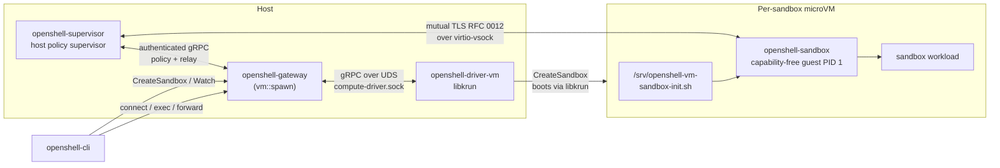

# openshell-driver-vm

> 状态：实验性。VM 计算驱动正在积极开发中。

独立的、由 libkrun 支持的 [`ComputeDriver`](../../proto/compute_driver.proto)，用于 OpenShell。网关将此二进制作为子进程启动，并通过 `openshell.compute.v1.ComputeDriver` Unix socket 接口与之通信。`openshell-supervisor` 作为原生宿主进程运行，而 `openshell-sandbox` 作为无特权的 PID 1 在每个 microVM 内运行，通过 virtio-vsock 施加客户机本地隔离。

新的 VM 代际通过 vsock 向宿主 CID 2 发起控制连接。Libkrun 将该客户机连接转发到 supervisor 受保护的 Unix socket；QEMU 使用每个客户机端口上的宿主 vsock 监听器，并在 TLS 认证前检查客户机 CID。现有协议角色和授权保持不变。运行中的旧代际保留其原始描述符；新启动的代际要求匹配的内嵌运行时和 supervisor 二进制。

驱动内嵌 libkrun、libkrunfw、客户机 OCI 解包器、可移植客户机沙箱以及自定义内核运行时。每个沙箱从缓存的不可变 bootstrap ext4 根磁盘加上每个沙箱的可写 overlay 磁盘启动。当请求的沙箱镜像与 bootstrap 镜像不同时，驱动在 bootstrap VM 内准备一个只读镜像 ext4 磁盘，并将解包后的 rootfs 挂载为沙箱的 lowerdir。

## 整体架构

调用方驱动配置默认禁用，包括驱动 JSON 中编码的上传工作流。GPU 设备及其受信任的 VFIO 管道暂时豁免于审批标签；现有 GPU 选择校验仍然适用。私有 rootfs 暂存不授权任意宿主路径。网关将其通用策略传递给其管理的 VM 子进程。参见[资源准入配置](../../docs/how-it-works/gateways/configuration.mdx#external-resource-admission)。



Supervisor 持有网关凭证、准入策略、provider 解析、中间件、网络代理和 relay 注册。沙箱不接收网关 JWT。每个 VM 代际获得不同的沙箱和 supervisor 通道密钥；客户机在启动工作负载前消费并删除其私有 bootstrap 文件。

`src/isolation/` 下 VM 特定的 RFC 0012 代码仅选择 vsock 传输，并将不可变的 VM 代际和镜像声明绑定到受保护的客户机配置和宿主描述符中。生命周期、认证、进程控制、二进制身份、转发和流式传输来自 `openshell-isolation-interface` 和 `openshell-sandbox`。

## 快速开始（推荐）

```shell
mise run gateway:vm
```

首次运行需要几分钟，期间 `mise run vm:setup` 会暂存 libkrun/libkrunfw/umoci，`mise run vm:supervisor` 会构建可移植 Linux 客户机沙箱及其小型静态 guest-init 辅助程序。开发任务还会构建原生宿主 supervisor。后续运行使用缓存。

默认情况下 `mise run gateway:vm`：

- 在 `127.0.0.1:18081` 上监听明文 HTTP。
- 使用 `nvcr.io/nvidia/base/ubuntu:24.04` 作为沙箱和 bootstrap 镜像。
- 将网关安装名称配置为 `vm-dev`，并通过写入 `~/.config/openshell/gateways/vm-dev/metadata.json` 向 CLI 注册相同名称。不修改工作区 `.env`。
- 将网关 SQLite DB 持久化到 `.cache/gateway-vm/gateway.db`。
- 将 VM 驱动状态（每个沙箱的 `overlay.ext4`、镜像缓存和 `run/compute-driver.sock`）放在 `/tmp/openshell-vm-driver-$USER-vm-dev/` 下，使 AF_UNIX socket 路径保持在 macOS `SUN_LEN` 限制内。
- 写入 `.cache/gateway-vm/gateway.toml`，设置 `[openshell.drivers.vm].driver_dir = "$PWD/target/debug"`，以便使用新构建的 `openshell-driver-vm`，而非 `~/.local/libexec/openshell`、`/usr/libexec/openshell` 或 `/usr/local/libexec` 中的旧安装副本。
- 仅当本地 collector 在 `http://127.0.0.1:4317` 监听时，才启用 OTLP trace 导出。否则省略 OTLP 配置以避免重复导出失败。

GPU 直通（VFIO）需传入 `-- --gpu` 并以 root 权限运行：

```shell
sudo -E env "PATH=$PATH" mise run gateway:vm -- --gpu
```

GPU 直通使用 VFIO，要求宿主支持 IOMMU、bind/unbind 操作需要 root 权限，以及兼容的沙箱镜像。公开的 GPU 概览见仓库 `README.md`。

通过以下方式之一将 CLI 指向网关：

```shell
openshell --gateway vm-dev status
openshell gateway select vm-dev    # 之后直接使用 `openshell <command>`
```

通过环境变量覆盖默认值：

```shell
# 自定义端口（被占用时快速失败）
OPENSHELL_SERVER_PORT=18091 mise run gateway:vm

# 自定义网关安装/CLI 名称 + 命名空间
OPENSHELL_VM_GATEWAY_NAME=vm-feature-a \
OPENSHELL_SANDBOX_NAMESPACE=vm-feature-a \
mise run gateway:vm

# 自定义沙箱镜像
OPENSHELL_SANDBOX_IMAGE=ghcr.io/example/sandbox:latest mise run gateway:vm

# 自定义 bootstrap 镜像，用于准备/启动目标镜像的 VM 运行时
OPENSHELL_VM_BOOTSTRAP_IMAGE=ghcr.io/example/bootstrap:latest mise run gateway:vm
```

清理：

```shell
rm -rf /tmp/openshell-vm-driver-$USER-vm-dev .cache/gateway-vm
rm -rf "${XDG_CONFIG_HOME:-$HOME/.config}/openshell/gateways/vm-dev"
```

## 手动等效操作

如果你想自行驱动启动而非使用 `mise run gateway:vm`（即 `tasks/scripts/gateway-vm.sh`）：

```shell
# 1. 将运行时产物 + 客户机沙箱暂存到 target/vm-runtime-compressed/
mise run vm:setup
mise run vm:supervisor          # 构建 Linux 客户机沙箱和静态 guest-init 辅助程序

# 2. 构建网关、原生宿主 supervisor 和驱动
OPENSHELL_VM_RUNTIME_COMPRESSED_DIR=$PWD/target/vm-runtime-compressed \
  cargo build -p openshell-gateway -p openshell-supervisor -p openshell-driver-vm

# 3. 仅 macOS：为 Hypervisor.framework 对驱动进行 codesign
codesign \
  --entitlements crates/openshell-driver-vm/entitlements.plist \
  --force -s - target/debug/openshell-driver-vm

# 4. 使用 VM 驱动启动网关
mkdir -p /tmp/openshell-vm-driver-$USER-vm-dev .cache/gateway-vm
cat > .cache/gateway-vm/gateway.toml <<EOF
[openshell]
version = 2

[openshell.gateway]
compute_driver = "vm"
disable_tls = true

[openshell.drivers.vm]
default_image = "<compatible-image>"
grpc_endpoint = "http://127.0.0.1:18081"
driver_dir = "$PWD/target/debug"
state_dir = "/tmp/openshell-vm-driver-$USER-vm-dev"
EOF

target/debug/openshell-gateway \
  --config .cache/gateway-vm/gateway.toml \
  --compute-driver vm \
  --disable-tls \
  --db-url "sqlite:.cache/gateway-vm/gateway.db?mode=rwc" \
  --port 18081
```

网关按以下顺序解析 `openshell-driver-vm`：`[openshell.drivers.vm].driver_dir`、常规安装位置（`~/.local/libexec/openshell`、`/usr/libexec/openshell`、`/usr/local/libexec/openshell`、`/usr/local/libexec`），然后是网关二进制同级目录。

## 网关与驱动配置

通过 `--compute-driver vm`、`OPENSHELL_COMPUTE_DRIVER=vm` 或 `[openshell.gateway]` 中的 `compute_driver = "vm"` 选择 VM 驱动。在 `[openshell.drivers.vm]` 中配置 VM 特定设置。

| 配置键 | 默认值 | 用途 |
|---|---|---|
| `grpc_endpoint` | 空 | 必填。原生宿主 supervisor 用于访问网关的 URL。宿主回环地址如 `http://127.0.0.1:<port>` 有效。旧客户机别名会规范化为宿主回环。此端点从不发送到 VM 内。 |
| `state_dir` | `target/openshell-vm-driver` | 每个沙箱的 overlay 磁盘、控制台日志、镜像缓存和私有 `run/compute-driver.sock` UDS。相对路径在驱动启动时解析为绝对路径。 |
| `driver_dir` | 未设置 | 覆盖搜索 `openshell-driver-vm` 的目录。 |
| `default_image` | OpenShell 基础镜像 | 创建请求未指定镜像时使用的沙箱镜像。 |
| `bootstrap_image` | 未设置 | 用作不可变 bootstrap 根磁盘的 VM 运行时镜像。仅回退到运维配置的 `default_image`；两者均为空时驱动拒绝启动。 |
| `vcpus` | `2` | 每个沙箱的 vCPU 数。 |
| `mem_mib` | `2048` | 每个沙箱的内存，单位 MiB。 |
| `overlay_disk_mib` | `4096` | 每个沙箱的稀疏可写 overlay 磁盘大小，单位 MiB。 |
| `krun_log_level` | `1` | libkrun 详细程度（0-5）。 |
| `guest_tls_ca` | 未设置 | 宿主 supervisor 网关 CA 证书的历史键名。`grpc_endpoint` 使用 `https://` 时必填；从不复制到客户机。 |
| `https_proxy` | 未设置 | 企业正向代理（`http://host:port` 或 `https://host:port`），宿主控制链通过它转发策略批准的 TLS CONNECT 出站流量。宿主回环代理 URL 可用，因为控制在网关宿主上运行。 |
| `no_proxy` | 未设置 | 仅用于企业代理的逗号分隔绕过列表。OpenShell 策略评估仍然适用。 |
| `proxy_auth_file` | 未设置 | 网关宿主上已验证的 `user:pass` 凭证文件路径。以仅 root 权限暂存到每个沙箱 overlay 中，并随沙箱删除；凭证从不进入日志或进程参数。 |
| `proxy_auth_allow_insecure` | 未设置 | 与 `proxy_auth_file` 配合对 `http://` 代理使用时必填：确认 Basic 认证在到代理的连接上是明文。 |
| `proxy_connect_by_hostname` | 未设置 | 在 CONNECT 中发送主机名而非已验证 IP。用于 ACL 拒绝 IP CONNECT 目标的代理的最后手段。 |
| `proxy_ca_bundle` | 未设置 | 网关宿主上受信任的 PEM CA 包，用于企业代理和 TLS 拦截的服务器证书。驱动验证它并将其暂存到受保护 overlay 中的固定非机密客户机路径。需要 `https_proxy`。 |
| `provider_spiffe_workload_api_tcp_endpoint` | 未设置 | 显式客户机可达的 `tcp:IP:port` SPIFFE Workload API 监听器，用于 provider token 交换。需要 `provider_spiffe_allow_guest_tcp = true`；宿主 UNIX socket 从不静默暴露给 VM 客户机。 |
| `enable_bind_mounts` | `false` | 允许每个沙箱的 `driver_config.vm.mounts` 宿主目录共享（仅 libkrun virtiofs）。驱动将 `tag\ttarget\tmode` 清单写入 overlay 中的 `/.openshell/mounts.manifest`，guest init 在 `/sandbox` 所有权修复后挂载每个共享。资源准入启用时拒绝。 |

代理设置由运维方拥有且为部署级别：不接受通过 `template.driver_config.vm` 传入，驱动仅将其传递给原生宿主控制。每个存在但无效的值在网关或沙箱启动时都是致命的，而非降级为直接拨号。

网关进程标志面参见 [`openshell-gateway --help`](../openshell-server/src/cli.rs)。

## 验证网关

网关由 `mise run gateway:vm` 自动注册。在另一终端：

```shell
./scripts/bin/openshell status
./scripts/bin/openshell sandbox create --name demo --from <compatible-image>
./scripts/bin/openshell sandbox connect demo
```

首个沙箱启动需要 10–30 秒（镜像拉取/准备/缓存 + libkrun + guest init）。若省略 `--from`，VM 驱动使用网关配置的默认沙箱镜像。既无 `--from` 也无 `--sandbox-image` 时，VM 沙箱创建失败。后续创建复用已准备的镜像缓存，启动前仅创建稀疏的每沙箱 `overlay.ext4`。

`CreateSandbox` 快速接受沙箱并在后台继续 VM 供应。驱动发布平台事件，涵盖镜像解析、缓存命中/未命中、层拉取、rootfs 准备、overlay 创建和 VM 启动器启动，以便 CLI 通过现有沙箱 watch 流显示进度。

VM 驱动维护两个镜像缓存。bootstrap 缓存是受控的 `rootfs.ext4`，用于启动 guest init 和 OpenShell supervisor。当请求的沙箱镜像与 bootstrap 镜像不同时使用已准备镜像缓存：宿主将 registry 层下载到有效 OCI 布局，将该载荷附加到临时 bootstrap VM，guest init 运行 `umoci raw unpack` 到 Linux 拥有的 ext4 存储。生成的磁盘缓存在 `<state-dir>/images/<cache-id>/rootfs.ext4` 下，并以只读方式附加到后续沙箱。本地 Docker 镜像仍导出为 rootfs tar 归档并在 bootstrap VM 内准备。驱动在缓存前检查已准备磁盘包含解包后的 rootfs；失败时不缓存任何内容并报告镜像准备控制台尾部。设置 `OPENSHELL_VM_IMAGE_PULL_CONCURRENCY` 调整 registry 层下载并行度（默认 `4`，最大 `16`）。两个缓存中的 registry 拉取均使用解析后的 digest 作为不可变引用。驱动在下载层前根据该 digest 验证下载的 manifest。对于多平台镜像，先验证 index，再验证所选平台 manifest。Digest 固定的请求保留调用方的 digest。缓存键对源身份进行哈希，以保持缓存和暂存文件名有界。Bootstrap 缓存布局 v6 和已准备镜像布局 v4 在首次使用时重建旧条目；旧缓存文件保留在磁盘上但不用于 registry 镜像。两个缓存均按源镜像身份和 OpenShell 版本划分，因此 OpenShell 升级会构建新的客户机 rootfs，而非复用带有旧内嵌 supervisor 的 rootfs。宿主侧 bootstrap 层组装保留留在 rootfs 内的相对符号链接，但在应用后续文件或 whiteout 前拒绝绝对或逃逸的跨层符号链接遍历。层应用器相对于已打开的目录句柄执行 rootfs 变更，并在不跟随符号链接的情况下创建目标文件。请求的沙箱镜像从不被选为 bootstrap 镜像。运维方必须配置 `bootstrap_image` 或 `default_image`；两者均为空时驱动在启动期间失败。

镜像和可写 overlay 准备在拥有的 worker 进程中运行。停止或删除沙箱会取消其 worker 和 formatter 进程，等待它们退出，然后删除该尝试在 `<state-dir>/images/preparations/` 下的临时文件。新 overlay（包括首次启动中断后的重试）在此构建，完成后才重命名到沙箱状态。worker 子进程继承的文件锁防止清理删除仍被进程拥有的文件。若清理无法确认进程已停止，操作返回错误并保留临时文件和沙箱状态。

启动时，驱动回收此目录中的非活跃尝试。保留活跃尝试、已提交的镜像缓存和旧版本的未标记暂存。并发准备序列化镜像缓存发布；中断的尝试无法将部分磁盘发布到现有缓存条目上。`rootfs_tar_path` 的网关上传槽保持其现有的独立生命周期。

每个沙箱获得自己的稀疏可写 `<state-dir>/sandboxes/<id>/overlay.ext4`。guest init 将 overlayfs 挂载为 `/`，存在已准备镜像 rootfs 时作为 lowerdir，否则直接使用 bootstrap rootfs。对 `/sandbox` 和其他可变路径的写入落在 overlay 中