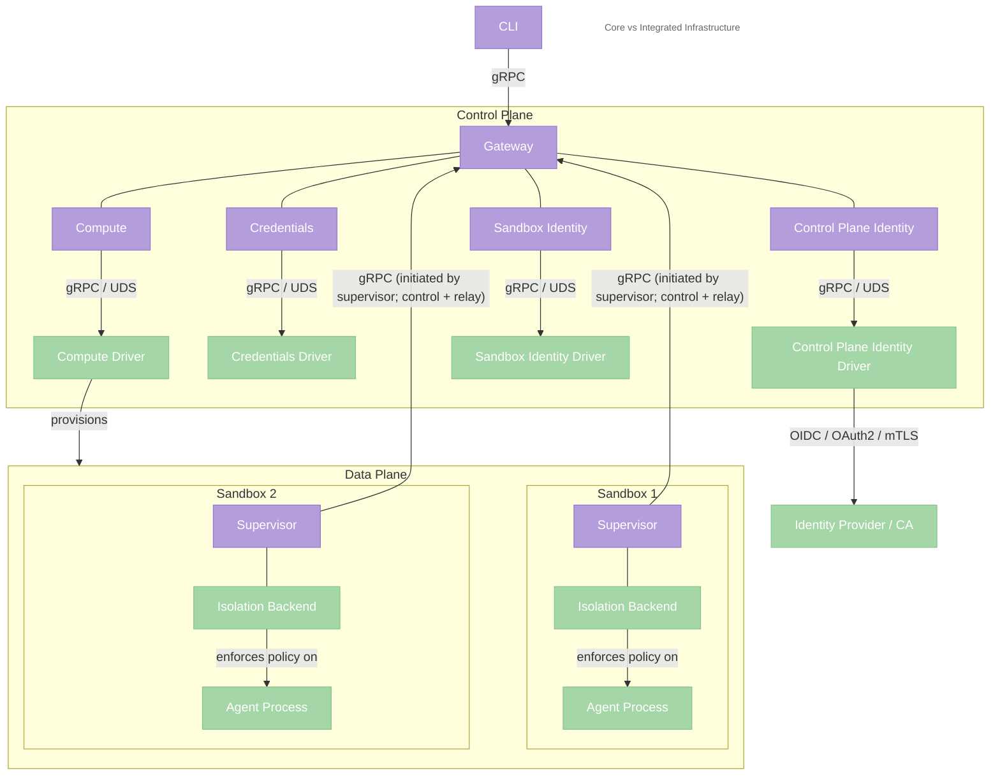
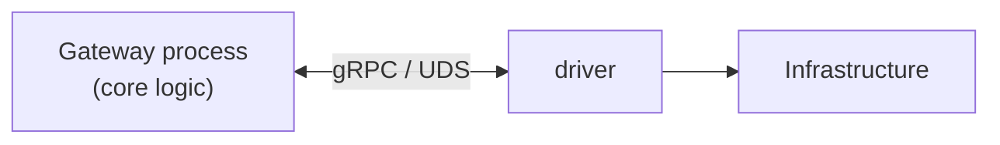

---
authors:
  - "@drew"
state: accepted
---

# RFC 0001 - 核心架构

## 摘要

本 RFC 为 OpenShell 提出一种可组合的核心架构，围绕三个运行时组件构建——**CLI**、**Gateway** 和 **Supervisor**——并将基础设施相关行为移至显式驱动接口之后。

本 RFC 提议围绕四个内部子系统组织网关：**compute**（沙箱生命周期）、**credentials**（密钥解析）、**control-plane identity**（网关认证与授权）和 **sandbox identity**（Supervisor 与沙箱工作负载身份）。每个子系统将平台相关操作委托给可插拔的**驱动**，使核心网关保持稳定，同时不同部署环境提供各自的基础设施适配器。

本 RFC 还提出三项控制平面约束：Supervisor 主动出站连接网关而非由网关拨入；初始设计中沙箱间流量通过网关中继；网关以多副本 active-active 服务运行，并对活跃 Supervisor 会话持有租约所有权。

## 动机

OpenShell 不应绑定单一基础设施环境。OpenShell 的核心价值——为自主 Agent 提供安全、策略强制的沙箱——应可跨部署目标移植。

当前网关与 Kubernetes 紧密耦合。`SandboxClient` 结构体直接通过 `kube-rs` 创建 AgentSandbox CRD、监听 Kubernetes 事件并解析 Pod IP。这种耦合使替代部署目标难以支持，并将基础设施关注点强加于核心网关。

同时，耦合面比整个系统窄。网关依赖 Kubernetes 进行沙箱供给、生命周期监听和网络地址解析，但网关其余部分——持久化状态、校验策略、管理 SSH 会话、路由推理、提供 gRPC API——本质上并不绑定 Kubernetes。Supervisor 耦合更少：它在给定环境中运行，通过 gRPC 回连网关，并执行安全边界。

本 RFC 提议将这些基础设施相关职责移至显式驱动接口之后。若在该边界提取驱动，CLI、Gateway 和 Supervisor 可保持稳定，平台相关行为则位于 compute、credentials、control-plane identity 和 sandbox identity 驱动之后。这使核心架构聚焦 OpenShell 语义，同时允许不同部署环境提供各自的基础设施适配器。

## 非目标

- **重写 Supervisor。** Supervisor 已具备平台感知能力。本 RFC 关注网关与基础设施之间的边界，而非沙箱运行时内部。
- **为每个部署目标提供一方驱动。** 我们定义接口并交付参考实现，但 OpenShell 的一方重点是基于 Kubernetes 的部署。其他环境可由第三方驱动支持。
- **规定特定技术或隔离原语。** 本 RFC 定义契约与职责，不强制 Docker、microVM、Kubernetes、Kata、gVisor 或任何特定运行时或隔离栈。这些是实现细节，留给集成方。

## 提案

### 核心架构

### 组件职责

**CLI。** 面向用户的接口。通过 gRPC 与网关通信。管理沙箱、策略、Provider 和推理配置。运行于 macOS、Linux 和 Windows。不感知网关使用哪个驱动——无论基础设施如何，相同命令均可工作。

**Gateway。** 控制平面。拥有沙箱状态、控制平面身份、沙箱身份、策略、exec 会话、推理路由、gRPC API 以及沙箱间路由/中继。内部协调四个子系统——**compute**（沙箱生命周期）、**credentials**（密钥解析）、**control-plane identity**（网关认证与授权）和 **sandbox identity**（Supervisor 与沙箱工作负载身份）——每个子系统将平台相关工作委托给各自的驱动。网关从不主动连接沙箱——Supervisor 主动出站连接网关，所有控制平面通信均流经这些 Supervisor 发起的连接。

**Supervisor。** 安全边界。无论沙箱环境如何创建，Supervisor 均在其中运行。执行网络策略（HTTP CONNECT 代理 + OPA）、文件系统隔离（Linux 上 Landlock）、系统调用过滤（Linux 上 seccomp）以及工作负载边界处的沙箱身份。通过 gRPC 回连网关以获取配置、策略、日志、凭证和对等中继设置。自动适配宿主平台——Linux 上完整隔离，无内核级支持的平台上仅代理。

### 网关接口

网关内部，四个子系统——**compute**、**credentials**、**control-plane identity** 和 **sandbox identity**——各自将平台相关操作委托给各自的驱动。

#### Compute

Compute 是网关中负责沙箱生命周期语义的子系统。它决定何时创建沙箱、跟踪其阶段转换、管理协调并协调拆除。Compute 调用其驱动的供给 RPC（`CreateSandbox`、`DeleteSandbox`、`WatchSandboxes`、`Reconcile`）执行平台相关操作，但生命周期逻辑——重试策略、状态机、顺序——位于 compute 而非驱动中。

#### Credentials

Credentials 是网关中负责凭证解析语义的子系统。当沙箱或网关需要密钥（LLM API 密钥、令牌、证书）时，credentials 将逻辑 Provider 名称映射到凭证，处理缓存与轮换，并将密钥交付给请求组件。它调用其驱动的凭证访问 RPC（`ResolveCredential`、`ListCredentials`）从平台原生密钥存储读取，但解析逻辑——名称映射、缓存、轮换策略、交付——位于 credentials 而非驱动中。

预期凭证存储后端（由驱动实现）：

- **macOS Keychain。** 通过 Security 框架从系统 Keychain 读取凭证。
- **Linux Secret Service（[freedesktop.org](https://freedesktop.org)）。** 通过 D-Bus Secret Service API（GNOME Keyring、KDE Wallet、KeePassXC 等）读取凭证。无 D-Bus 会话时回退到加密文件存储。
- **Windows Credential Manager。** 从 Windows Credential Manager（DPAPI 支持）读取凭证。
- **HashiCorp Vault。** 使用 AppRole、Kubernetes 认证或令牌认证从 Vault 获取凭证。
- **Kubernetes Secrets。** 从网关命名空间中的 Kubernetes Secrets 读取凭证。

#### Control-plane identity

Control-plane identity 是网关中确定谁在向控制平面发起请求以及是否允许执行该请求的子系统。它通过委托给其驱动的身份验证 RPC 来认证 CLI 用户、操作员和外部服务，并评估授权策略。与 compute 和 credentials 一样，control-plane identity 拥有业务逻辑——会话管理、令牌缓存和授权策略评估——而驱动提供平台相关的认证机制。当前 mTLS 客户端证书路径也属于此处：它认证调用方到网关，但不建立沙箱工作负载身份。它有意仅限控制平面身份；沙箱和 Supervisor 身份由单独的 sandbox identity 子系统处理。

预期控制平面身份后端（由驱动实现）：

- **本地 OS 用户。** 将 Linux/macOS 系统用户映射到网关身份。驱动信任连接进程的 OS 级用户身份（例如通过 Unix 域套接字对端凭证）。适用于本地部署。
- **mTLS 客户端证书。** 使用受信任 CA 签名的客户端证书认证调用方到网关。这与当前默认网关认证模式一致。适用于自部署网关和本地部署，但仍属控制平面认证而非沙箱工作负载身份。
- **OIDC/OAuth2。** 验证来自外部身份提供方（例如 Keycloak、Okta 或 Auth0）的 Bearer 令牌。适用于与控制平面访问的外部身份提供方集成。
- **静态 RBAC。** 基于角色的访问控制，角色和绑定定义在网关配置文件中。无外部依赖。适用于简单的内置访问控制。

#### Sandbox identity

Sandbox identity 是独立的网关子系统，管理 Supervisor 和沙箱的身份。当 Supervisor 回连网关以及网关授权沙箱间通信时使用。这将工作负载身份与用户和操作员身份区分开：通过 OIDC 认证到网关的人类与证明自身工作负载身份的沙箱不是一回事。

预期沙箱身份后端（由驱动实现）：

- **SPIFFE/SPIRE。** 通过 SPIFFE 可验证身份文档（SVID）验证工作负载身份。适用于网关、Supervisor 和支持基础设施之间通过 mTLS 的工作负载身份。
- **网关签发的工作负载身份。** 在不依赖外部工作负载身份系统的环境中，为 Supervisor 签发并验证网关管理的证书或其他引导凭证。

### 驱动加载

每个驱动是独立进程，由网关启动并通过本地套接字上的 gRPC 通信。网关管理四个独立驱动进程——分别用于 compute、credentials、control-plane identity 和 sandbox identity。

**生命周期（每个驱动）：**

1. 网关读取配置，确定每个组件使用哪个驱动。
2. 启动每个驱动进程（磁盘上的二进制文件）。
3. 每个驱动在 Unix 域套接字（或 localhost 端口）上启动 gRPC 服务器。
4. 网关作为 gRPC 客户端连接，调用 `GetCapabilities` 验证每个驱动就绪。
5. 每个组件通过各自的 gRPC 连接调用各自的驱动。
6. 若驱动进程死亡，网关检测到连接断开并可独立重启。

**一方驱动**与网关一同发布在我们发布的容器镜像中，作为独立二进制文件（例如 `openshell-compute-k8s`、`openshell-credentials-vault`、`openshell-control-plane-identity-mtls`、`openshell-control-plane-identity-oidc` 和 `openshell-sandbox-identity-spiffe`）。OpenShell 的一方驱动重点是基于 Kubernetes 的部署，网关知道如何按名称查找并启动这些驱动。

**第三方驱动**是实现相应 gRPC 服务契约（`ComputeDriver`、`CredentialsDriver`、`ControlPlaneIdentityDriver` 或 `SandboxIdentityDriver`）的二进制文件。网关配置指向每个驱动的二进制路径，启动它并通过本地套接字连接。这些驱动预期位于各自仓库而非主 OpenShell 仓库。

此模型类似 HashiCorp 工具（Terraform、Nomad）处理插件的方式——独立二进制、gRPC 通信、无共享地址空间。按组件拆分意味着驱动可独立开发、版本化和部署。团队可升级 credentials 驱动而不影响 compute、control-plane identity 或 sandbox identity。

### 驱动版本管理

由于驱动是独立二进制，版本管理适用于一方和第三方驱动。每个驱动 API 应位于主版本化的 gRPC/protobuf 包下，例如 `openshell.compute.driver.v1`，每个驱动应暴露 `GetCapabilities` 握手，报告自身版本、支持的网关版本以及实现的可选功能。

在给定驱动 API 主版本内，变更应保持向后兼容：可添加新字段、RPC 和功能，但破坏性线格式或语义变更需要新主版本。网关应仅加载实现受支持 API 主版本并声明与运行中网关版本兼容的驱动。这使一方和第三方驱动的契约保持一致，并为 OpenShell 提供稳定的协议演进路径。

### 网关-Supervisor 连接

网关与 Supervisor 之间的所有通信均流经 **Supervisor 发起的连接**。网关从不主动连接沙箱。此架构选择减少了必须位于网关中的基础设施相关连接逻辑。

#### 连接生命周期

1. Compute 指示其驱动创建沙箱环境并在其中启动 Supervisor 进程。驱动传入 `OPENSHELL_GATEWAY` 环境变量。
2. Supervisor 主动出站连接网关的 gRPC 端点。
3. 连接时，Supervisor 出示其沙箱身份，标识自身（沙箱 ID、标签），并与网关建立长期认证会话。
4. 网关在沙箱注册表中注册 Supervisor，并开始通过此连接流式传输配置、策略和凭证。
5. 所有后续控制平面通信——配置更新、策略推送、凭证交付、日志流、exec 会话——均流经此 Supervisor 发起的连接。
6. 若连接断开，网关将沙箱标记为不可达。Supervisor 以指数退避重连。

#### Exec 会话

在 Supervisor 发起连接模式下，exec 会话（交互式 Shell 访问）复用在 Supervisor 到网关的现有 gRPC 连接上。流程为：CLI 向网关发送 exec 请求，网关通过 Supervisor 的入站 gRPC 流转发，Supervisor 打开本地 Shell 并桥接 I/O。

具体复用协议（双向流 RPC、WebSocket 升级等）留给后续 RFC。本 RFC 确立架构约束：exec 流经 Supervisor 发起的连接，而非单独的网关到沙箱路径。

#### 为何不由网关发起？

若网关主动连接 Supervisor，每个驱动都必须解决连接问题：网关如何进入其创建的环境？在 Kubernetes 上是 Pod IP；在 Docker 上是端口映射或桥接网络；在 NAT 后的远程机器上是隧道或中继服务。每个驱动不仅需提供地址，还需提供连接机制，网关需要可插拔传输层来使用它。

Supervisor 发起连接反转了这一点。对驱动的唯一网络要求是：Supervisor 能出站连接到已知端点。这减少了每个驱动必须满足的网络假设。

#### 沙箱间通信

某些工作负载需要沙箱协作，例如编排器沙箱调用工作沙箱。初始架构中，沙箱间流量**通过网关中继**。

**路由模型。** 网关既是目录服务也是中继。当 Supervisor A 需要访问沙箱 B 时，按沙箱身份和服务名向网关请求。若策略允许连接，网关在两个沙箱已认证的网关-Supervisor 会话上打开或绑定中继流，并在其间转发流量。此模型中网关从不分发 Supervisor 通告的对等端点。

这使对驱动的网络要求保持狭窄。唯一网络要求与控制平面流量已要求相同：每个 Supervisor 能维持到网关的出站 gRPC 连接。驱动无需为沙箱间流量提供共享网络寻址、DNS 或对等可达性。

**策略执行。** 沙箱间流量在中继建立时使用已认证的源沙箱身份、目标沙箱身份和请求的服务名进行授权。策略可以：

- 允许沙箱 A 访问沙箱 B 暴露的特定服务
- 默认拒绝所有沙箱间流量（完全隔离）
- 允许沙箱间通信但拒绝互联网（气隙协作）

由于对等流量通过已认证网关会话中继，Supervisor 无需通告对等可达地址，网关也无需信任该地址。这简化了第一版的安全模型。

**未来演进。** 后续 RFC 可能添加直接或更分布式的沙箱间传输，作为高带宽或低延迟工作负载的优化。若如此，必须保持相同授权模型，并在网关分发任何通告对等端点前引入沙箱身份与该端点之间的已认证绑定。

### 水平扩展

网关以 active-active 模式运行。多个网关副本可同时服务同一集群，正常运行时无单一控制器副本。持久状态——沙箱、策略