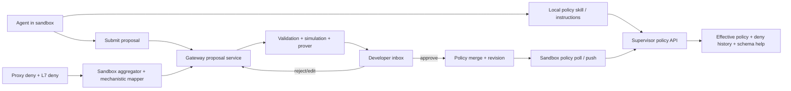
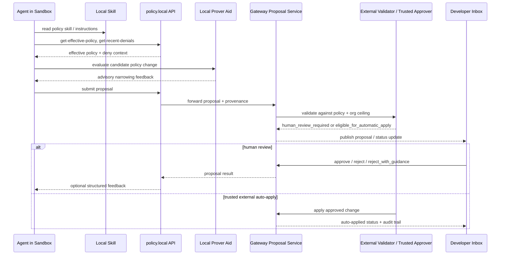

---
authors:
  - "@alwatson"
state: accepted
links:
  - https://github.com/NVIDIA/OpenShell/issues/1062
  - https://github.com/NVIDIA/OpenShell/blob/main/architecture/policy-advisor.md
---

# RFC 0002 - Agent 驱动的策略管理

<!--
See rfc/README.md for the full RFC process and state definitions.
-->

## 摘要

将 OpenShell 现有的 Policy Advisor 演进为 Agent 驱动的策略管理系统：Agent 可查看当前沙箱策略、起草范围最小的策略变更、提交审核，并在无需重启沙箱的情况下应用已批准的更新。安全模型保持不变：沙箱侧分析、网关侧校验与持久化、明确的审批边界。主要变化在编写与审核体验：每个沙箱都应暴露本地策略指引和 API，每个开发者界面都应提供响应式的收件箱来审核提案。

## 动机

OpenShell 已具备动态策略编辑的核心能力：

- 沙箱代理发出拒绝事件。
- 沙箱侧的 `DenialAggregator` 和机制化映射器将其转换为 `PolicyChunk` 草案提案。
- 网关持久化提案，并将已批准的规则合并到生效策略中。
- TUI 和 CLI 已提供审核与审批流程。
- 运行中的沙箱已支持动态策略热重载。

基础扎实，但当前体验本质上仍是运维驱动的、以网络为中心。它擅长"观察一次拒绝，批准一条生成的端点规则"，但无法兑现更完整的产品承诺：Agent 应能理解什么被阻止、发现可用的策略语言、生成最窄的合法策略变更，并连同足够的理由和验证信号提交给开发者，使审批快速且可信。

这很重要，因为：

- 开发者不应先学策略语法才能高效工作
- Agent 拥有最多的任务上下文，往往能起草比人更窄的变更
- 审批应像审核一个已验证的结果，而不是猜测 YAML diff
- 收件箱体验必须在 TUI、CLI 和 SDK 上快速且清晰
- 组织需要一条从人工审批到可信有界自动化的路径，同时不丢失可审计性和最小权限

本 RFC 提出下一层：让策略适配成为有意的、Agent 原生的工作流，而非被动的运维便利。

## MVP 实现说明

首个实现跟踪于 [#1062](https://github.com/NVIDIA/OpenShell/issues/1062)。它有意从能验证产品体验的最小 Agent 驱动闭环开始：

- 结构化的 L7 REST 拒绝响应，使 Agent 可读失败原因
- 沙箱本地 `policy.local` HTTP API，基于现有文件、日志和每沙箱 mTLS 网关调用
- 沙箱本地静态 Agent 指引，位于 `/etc/openshell/skills/policy_advisor.md`
- 在现有草案策略流程中加入 Agent 编写的提案来源、校验状态和拒绝指引
- 单沙箱的 TUI/CLI 审核，MVP 以轮询作为刷新路径

MVP 有意推迟：supervisor Unix socket API、多沙箱服务端流式收件箱、Slack/web 适配器、组织上限、可信自动应用、进程内 prover 优化。这些仍与本 RFC 方向一致，但并非验证初始闭环所必需。

整个 MVP 界面由 `agent_policy_proposals_enabled` 设置控制（见 `crates/openshell-core/src/settings.rs`），默认 false。禁用时，supervisor 不安装 skill，`policy.local` 路由返回 `404 feature_disabled`，L7 拒绝响应体省略 `next_steps` 数组。该开关独立于每提案的开发者审批门；功能开启时两者同时生效。视为软发布：闭环验证后按沙箱或全局启用；在不应提供 Agent 编写提案的环境中保持关闭。

## 非目标

- 允许沙箱内 Agent 自行批准或单方面应用自己的策略变更。
- 将提案生成移入网关。沙箱侧分析仍是架构默认。
- 首个版本解决所有策略域。网络策略是初始范围，因为它是当前架构中唯一可热重载的策略域；文件系统和进程策略可通过不同的生命周期模型后续跟进。
- 替换现有机制化映射器。它仍是确定性基线和安全网。
- 将 Rego 编写作为终端用户的直接要求。系统应向 Agent 和高级用户暴露策略语义，而非要求常见工作流手写策略。

## 提案

### 执行模型

本 RFC 并非提出一个不指定执行内容的通用"策略更新"系统。目标模型是分层的：

- **L4 仍是通用基线**
  所有出站连接由主机、端口和二进制身份门控。
- **L7 是受支持应用协议的首选最小权限模型**
  目前主要指 `protocol: rest`，对 HTTP API 提供按方法和按路径的规则。
- **协议感知或工具感知的策略层可在有用时位于 L7 之上**
  MCP 是未来更高层执行面的有力候选，但应显式建模而非隐含。

本 RFC 的初始实现应基于 OpenShell 代码库现有的执行模型：

- 所有出站流量的 L4 网络策略
- 配置 `protocol: rest` 的 HTTP API 的 L7 REST 执行
- 能区分仅 L4 访问与 L7 执行的策略 prover 检查

这很重要，因为"允许 GitHub"不是单一概念：

- `git` 使用的 `github.com:443` 可能依工作流和协议行为需要仅 L4 允许
- `gh`、`curl` 或 SDK 使用的 `api.github.com:443` 通常非常适合 L7 REST 控制
- 最佳最小权限设计往往拆分这些路径，而非将 GitHub 视为一个宽泛能力

因此本 RFC 设计上网络优先，并非其他策略域不重要，而是当前 OpenShell 架构仅支持 `network_policies` 的实时变更。文件系统、Landlock 和进程设置在沙箱启动时应用，目前在沙箱生命周期内不可变。

### 产品方向

每个 OpenShell 沙箱都应能承载 Agent 可用的策略工作流，具备四项核心能力：

1. 本地能力描述，教会 Agent 如何查看当前策略状态、理解可用策略语言并提交提案供审核。
2. 沙箱本地或 supervisor 邻近的 API，用于读取生效策略、近期拒绝、沙箱本地活动日志和提案状态。
3. 网关管理的开发者收件箱，用于实时审核、编辑、批准、拒绝和审计提案。
4. 在应用前校验拟议策略变更的流水线。

产品标准不仅是正确性。交互模型本身也必须优秀：

- 拒绝或 Agent 请求后提案应快速出现
- 审核界面无需策略专业知识即可理解
- 同一提案在 TUI、CLI 和 SDK 中应表现一致
- 系统高置信时审批应一步完成
- 高容量探索性 Agent 工作流不应让用户淹没在重复提示中

### UX 要求与延迟目标

开发者收件箱体验：

- OpenShell **必须提供推送/订阅路径**，将提案和决策更新送达 TUI、CLI 和 SDK。
- 轮询可作为回退，但仅轮询不足以支撑目标 UX。

目标 UX 指标：

- **提案出现延迟**
  从网关接受提案或可操作的拒绝派生建议，到其出现在已连接收件箱客户端：
  - 目标 `p50 <= 2s`
  - 目标 `p95 <= 5s`
- **决策传播延迟**
  从网关批准、拒绝、编辑或自动应用，到所有已连接收件箱客户端反映新状态：
  - 目标 `p50 <= 1s`
  - 目标 `p95 <= 3s`
- **激活反馈延迟**
  从网关收到沙箱策略状态（`loaded` 或 `failed`）到客户端可见状态更新：
  - 目标 `p50 <= 1s`
  - 目标 `p95 <= 3s`

若沙箱策略激活超过这些目标，收件箱仍应立即更新为中间状态（如 `pending_activation`），而非让用户不确定。

期望用户体验：

1. Agent 遇到拒绝，沙箱 supervisor 给出结构化解释。
2. Agent 使用本地策略管理 skill 查看当前生效策略、拒绝上下文和相关策略原语。
3. Agent 生成最小拟议变更，通过稳定的提案 API 提交。
4. 开发者在 TUI、CLI 或 SDK 中看到提案，审核其理由和校验结果，批准或拒绝。
5. OpenShell 将已批准变更作为热重载策略更新应用，并保留持久审计轨迹。

### 现状

本 RFC 明确基于现有代码库构建，而非替换。

当前实现点：

- `crates/openshell-sandbox/src/denial_aggregator.rs`
  沙箱侧拒绝事件聚合。
- `crates/openshell-sandbox/src/mechanistic_mapper.rs`
  确定性生成 `PolicyChunk` 草案建议，含部分 L7 支持。
- `crates/openshell-server/src/grpc/policy.rs`
  持久化、审批、合并、拒绝、编辑、撤销和策略修订处理。
- `crates/openshell-tui/src/ui/sandbox_draft.rs`
  网络规则的 TUI 审核与审批界面。
- `crates/openshell-cli/src/run.rs`
  `openshell rule get|approve|reject|approve-all|history`。
- `architecture/policy-advisor.md`
  当前沙箱侧建议设计。

已存在且应保留的重要能力：

- 沙箱侧提案生成
- 可热重载的策略更新
- `proto/openshell.proto` 中的提案编辑和撤销 RPC
- 持久草案块存储和审批历史
- 无需 LLM 的确定性机制化提案路径
- 仅 L4 与 L7 REST 执行的真实区分

### 缺失部分

当前实现缺少目标开发者体验所需的若干部分：

- 供本地 Agent 使用的标准沙箱内 skill 或指令包。
- Agent 可有意使用的一等提案 API，而非仅通过拒绝触发分析。
- 超越主机/端口/二进制的丰富提案上下文，尤其是开发者意图、仓库/任务上下文和写操作。
- 在审批前解释提案将允许什么的校验输出。
- 通用"开发者收件箱"模型，可从同一后端抽象驱动 TUI、CLI、SDK 及未来 Slack/web 界面。
- 清晰区分：
  - 观察到的拒绝事件，
  - Agent 编写的策略变更，
  - 已验证的可审批提案，
  - 已应用的策略修订。
- 非人类审批者的信任模型：可信外部 Agent 可在变更处于组织定义的最大策略包络内时自动应用策略变更。
- 提案的显式语义，标明建议是：
  - 仅 L4
  - L7 REST
  - 从 L4 到 L7 的转换
  - 未来协议感知策略类型，如 MCP 感知控制

### 架构

重要架构原则：当前 Policy Advisor 流水线成为提案的一个生产者，而非唯一生产者。Agent 编写的提案和机制化提案应进入同一网关收件箱，经过相同的校验和审批机制。

第二架构原则：审批是策略驱动的。人工审批是默认模式，但同一机制也必须支持可信外部控制平面判定提案因符合更高层组织约束而可安全自动应用。

端到端交互应如下：

### 核心设计概念

#### 1. 每个沙箱内的策略工作区

每个默认沙箱应暴露稳定的本地"策略工作区"，供 Agent 依赖。它不一定是检入用户仓库的可变文件；它是沙箱内可用的能力界面。

工作区应提供：

- 已解析到当前活动版本的生效沙箱策略。
- 与沙箱支持的策略特性相关的策略 Schema 和示例。
- 审批工作流语义描述。
- 近期拒绝、沙箱本地活动日志和相关提案历史。
- 生成最窄变更的指引。

首个实现可为静态 `/etc/openshell/skills/policy_advisor.md` 加沙箱本地 `policy.local` HTTP API。长期契约是 API；skill 是易用的入口。MCP 可后续包装此 API，供受益于工具发现的 Agent 使用，但不应成为首个承重协议或独立实现路径。

沙箱面向界面必须有明确信息边界：

沙箱内 Agent 可见：

- 当前生效沙箱策略
- 该沙箱的拒绝原因、沙箱本地日志和本地提案历史
- 支持的策略原语和示例
- 粗粒度提案结果，如 `needs_human_review`、`eligible_for_external_review` 或 `rejected_for_safety`

不直接暴露给沙箱内 Agent：

- 完整组织上限策略文档
- 可信外部审批者策略或评分启发式
- 隐藏审批阈值
- 其他沙箱、用户或组织工作流的策略状态

上限评估、信任决策和自动应用资格应在沙箱外计算。

OpenShell 还应向 Agent 提供 prover 支持的分析作为提案编写辅助。Agent 可测试候选策略是否超出必要范围，并在提交前迭代至更窄提案。沙箱内 prover 输出仅为建议，用于起草。审批和自动应用决策仍须依赖网关或可信审批者路径的外部校验。

#### 2. 有意的提案提交 API

新增 supervisor 面向的提案 API，使 Agent 可在拒绝聚合周期之前或之后提交策略更新。

Agent 操作示例：

- "显示影响 `git` 的当前策略。"
- "解释这次 GitHub push 为何被拒绝。"
- "起草最小规则，仅允许 `git` 对 `github.com` 和 `api.github.com` 的写操作。"
- "将此提案提交人工审核。"

提案路径应支持两种模式：

- `draft_from_observation`
  基于真实拒绝历史构建。
- `draft_from_agent_intent`
  允许 Agent 基于计划工作主动请求变更。

两者都应进入同一收件箱并捕获来源。

当多个生产者提交实质相同的提案时，网关应应用确定性合并策略：

- 机制化提案建立基线提案记录
- 同一沙箱 + 端点 + 二进制的更丰富 Agent 提案可升级现有记录的理由、上下文和拟议 L7 细化
- 回退观察更新可继续增加命中计数和时间戳，而不丢弃更丰富元数据

重要产品要求：更丰富的 Agent 提案不得被更早的机制化提案静默丢失。

#### 3. 提案模型演进

将现有 `PolicyChunk`/草案块模型扩展为更具表达力的提案对象，同时保持当前规则审核命令的向后兼容。

应新增字段：

- 提案来源：机制化、Agent 编写或混合。
- 用平实语言描述请求能力摘要。
- 校验状态和发现摘要。
- 与当前生效策略的 diff。
- 首版提案类型的执行层：
  - `l4`
  - `l7_rest`
- 预期范围：
  - 仅端点
  - L7 方法/路径
  - 二进制限制
  - 时间或会话限制（若后续支持）
- 可选任务上下文：
  - 仓库 URL
  - Issue/RFC 引用
  - 触发需求的命令或工具

收件箱应明确提案是 L4 隧道、L7 REST 规则，还是从宽泛访问到更窄 L7 控制的转换。

未来协议感知提案类型（如 MCP 感知控制）应后续扩展模型，而非迫使首版 Schema 过早泛化。

#### 4. 审批前校验

审批应呈现已验证的后果，而非仅拟议规则。

校验阶段：

1. Schema 和静态安全校验。
2. 确定性模拟：
   - 哪些新主机、端口、方法或二进制将变为可达
   - 变更是否重叠或拓宽现有规则
   - 提案是仅 L4 还是受 L7 执行保护
3. 策略特定安全检查：
   - 始终阻止的目标
   - 可疑私有 IP 覆盖
   - 通配符或全访问扩展
   - 绕过 L7 检查的二进制或协议
4. 支持时进行形式验证：
   - 使用现有 prover 基础设施检查提案满足声明意图且不超出

校验器应输出审批摘要，例如：

- "允许 `git` 访问 `github.com:443` 和 `api.github.com:443`。"
- "不授予其他 GitHub 主机访问。"
- "为仓库 push 语义添加可写 REST 路径。"
- "仅触及动态网络策略。"
- "此变更为仅 L4，不提供方法/路径限制。"
- "此变更将端点升级为 L7 REST 执行。"

校验还应支持两种决策模式：

- `human_review_required`
  提案显示