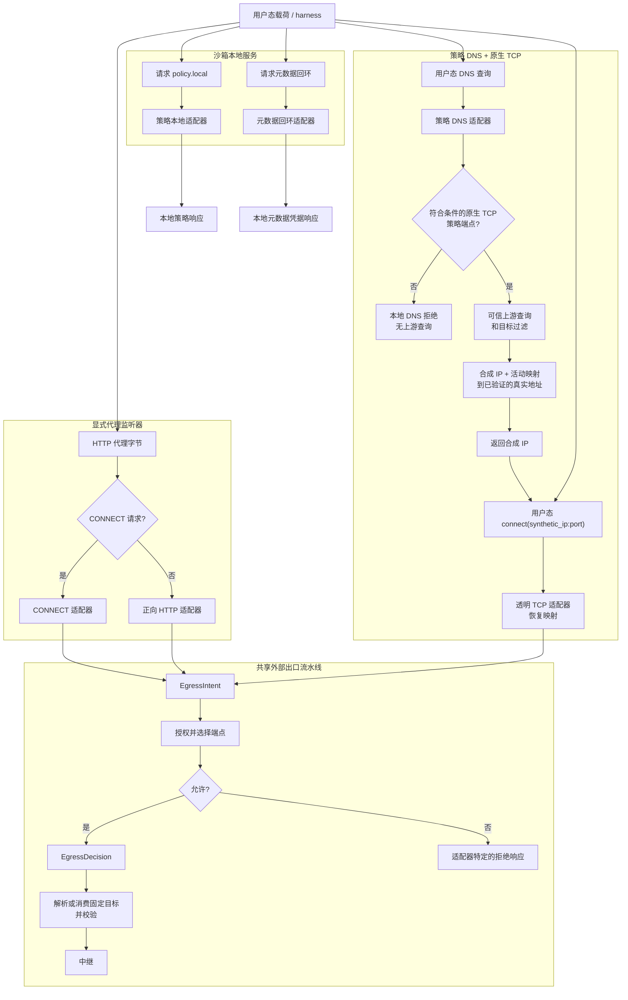
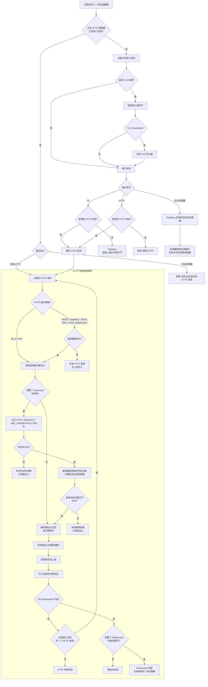
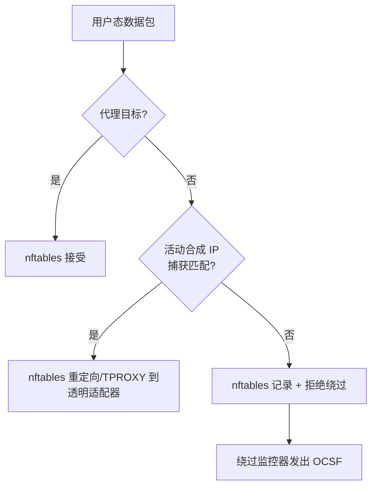

---
authors:
  - "@johntmyers"
state: review
links:
  - https://github.com/NVIDIA/OpenShell/issues/1107
  - https://github.com/NVIDIA/OpenShell/pull/2155
  - https://github.com/NVIDIA/OpenShell/pull/1083
  - https://github.com/NVIDIA/OpenShell/pull/1151
  - https://github.com/NVIDIA/OpenShell/pull/1286
  - https://github.com/NVIDIA/OpenShell/pull/1511
  - https://github.com/NVIDIA/OpenShell/pull/1738
  - https://github.com/NVIDIA/OpenShell/pull/2027
  - https://github.com/NVIDIA/OpenShell/pull/1865
  - https://github.com/NVIDIA/OpenShell/pull/1938
---

# RFC 0005 - 沙箱代理出口适配器模型

<!--
完整的 RFC 流程和状态定义见 rfc/README.md。
-->

## 摘要

围绕共享的授权、目标校验和中继边界重构沙箱出口。CONNECT、正向 HTTP、原生 TCP 捕获、策略 DNS、`policy.local` 和元数据回环变为窄适配器，将用户态入口点转换为通用运行时意图。策略评估、目标校验、supervisor 中间件、凭据注入、请求体重写、WebSocket 处理、协议处理和上游拨号都在共享边界之后完成。

本 RFC 描述完整的前瞻架构，设计为跨多个 Pull Request 增量落地。第一个里程碑仅重构 CONNECT 和正向 HTTP，提取共享原语，并保留所有当前面向用户的功能和执行行为。后续里程碑在这些边界之上添加策略 DNS、透明 TCP 捕获、原生协议处理器和可选部署形态。

代码库已朝此方向推进：网络拆分为 `openshell-supervisor-network`，进程/netns 工作拆分为 `openshell-supervisor-process`。本 RFC 提出下一个内部边界：让代理入口机制可插拔，而不重复授权、目标校验或中继行为。

补充细节见：

- [当前形态附录](current-shape.md)
- [技术设计附录](technical-design.md)
- [实施计划](implementation-plan.md)

## 动机

沙箱代理支持多种连接面：显式 CONNECT、正向 HTTP、本地推理和策略 API、元数据回环、TLS 终止、REST、GraphQL、JSON-RPC、MCP 和 WebSocket 检查、凭据注入、supervisor 中间件，以及基于 nftables 的绕过检测。这些功能很有价值，但策略和执行变更仍倾向于触及多条入口路径。

风险在于执行不对称。安全修复可能加到 CONNECT 却漏掉正向 HTTP；端点元数据的选择可能与记录的策略不同；凭据路径可能获得请求体或 WebSocket 支持，而另一中继模式却没有相同行为。

目标形态分离三个关注点：

- **适配器**描述用户态如何到达网络组件。
- **授权**决定出口是否允许以及适用何种端点行为。
- **中继**负责字节、凭据、协议解析和上游拨号。

第一个里程碑针对当前嵌入式/仅网络 supervisor 运行时，在内部接缝移动时保留其现有面向用户的行为。随后同一组边界支持策略 DNS 和透明 TCP、原生协议处理以及未来部署模式，而不重复授权或中继逻辑。

## 非目标

- 用正向代理替换 CONNECT 作为唯一的显式代理模式。
- 添加 SOCKS 支持。
- 本次重构不添加 HTTP/2 L7 解析。被检查的 HTTP 路径应继续拒绝不支持的 h2c 升级，而不是静默升级为原始流量。
- 重新设计提供方凭据存储。
- 重新引入 iptables 作为沙箱包过滤后端。
- 使用 eBPF connect 钩子进行透明捕获。原生 TCP 捕获需要在字节流中有用户态代理，以进行 TLS 终止和协议解析。
- 添加策略声明的 supervisor 代理主机本地端点。Issue [#1633](https://github.com/NVIDIA/OpenShell/issues/1633) 可在单独的功能工作中消费这些边界。
- 在兼容性重构期间改变现有仅端点运行时的进程身份语义。未来无身份部署模式需要明确的能力契约，不能意外继承仅端点行为。

## 提案

### 迁移大块

1. **传输和本地服务适配器。** CONNECT、正向 HTTP、透明 TCP、策略 DNS、`policy.local` 和元数据回环变为小适配器。它们解析各自的表面，产生出口意图、本地响应或 DNS 应答。它们不重复策略评估。
2. **出口意图和决策。** 共享授权对每个连接意图评估一次 L4 策略和端点选择，返回一个决策，包含匹配的策略、匹配的端点、用于评估的可选进程身份证据、允许的 IP 元数据、TLS 行为、协议执行以及凭据注入和中间件计划。
3. **中继。** 中继接收已授权的目标连接器，而不是已打开的上游套接字。HTTP 中继在每次请求上游写入前评估。TCP 中继为仅 L4 端点复制字节，或在端点策略要求原生协议执行时将流转交给协议处理器。

第一个实施里程碑通过现有独立查询填充兼容性 `EgressDecision`，使类型提取不改变行为。该过渡信封不是目标单一授权结果。代际一致的具体化和确定性端点选择在影子比较后单独切换，之后传输适配器才依赖该结果。

### 统一适配器流程

每个适配器仍拥有其响应形态。若授权拒绝 CONNECT 意图，CONNECT 适配器返回隧道拒绝。若正向 HTTP 被拒绝，正向适配器返回 HTTP 拒绝。若策略 DNS 拒绝名称，返回相应 DNS 响应。共享层决定结果；适配器为其协议渲染结果。

### 中继流程

将其理解为两个阶段。上半部分根据适配器表面和端点执行选择中继形态。`HTTP 中继请求循环`仅接收已解析的 HTTP 请求。Supervisor 中间件不是另一个策略漏斗；它是可选请求路径钩子，在 HTTP 策略允许请求之后、OpenShell 管理的凭据注入之前运行。当中间件更改请求体时，中继重新解析依赖请求体的协议输入，并在凭据注入或上游写入前重新评估请求策略。

中继规则：

- HTTP 凭据注入在两种 HTTP 模式下都发生：仅 L4 HTTP 和 HTTP 检查。
- HTTP 检查端点包括 `rest`、`graphql`、`json-rpc`、`mcp` 和 `websocket`。JSON-RPC 和 MCP 是 HTTP L7 协议，不是原生 TCP 协议处理器。
- Supervisor 中间件是类型化中继钩子。V1 中间件在 `HTTP_REQUEST / PRE_CREDENTIALS` 对已解析 HTTP 请求运行，在网络和请求策略准入请求之后、OpenShell 注入凭据之前。
- 中间件可以允许、拒绝、替换有界请求体、添加批准的头部，并发出审计安全的发现/元数据。外部中间件不得接收 OpenShell 管理的凭据。
- 中间件变更不能绕过请求策略。请求体替换后，中继在凭据注入或上游写入前重新解析并重新评估依赖请求体的 GraphQL、JSON-RPC 和 MCP 策略输入。策略不匹配遵循端点配置的执行模式；格式错误或无法分类的转换后协议体即使在审计模式下也失败关闭。
- 凭据注入包括静态占位符重写和端点绑定的动态令牌授予。令牌授予在策略允许后、上游写入前运行；失败则拒绝且不转发请求。
- 中间件转换的内容不得创建解析 OpenShell 凭据占位符的新路径，除非中间件钩子被明确信任为具备凭据能力。安全默认是在凭据注入前对新引入的保留占位符失败关闭。
- 静态凭据重写覆盖请求目标、查询、头部、可选 REST 请求体以及可选客户端到服务器 WebSocket 文本帧。
- HTTP L7 策略在每次请求上游写入前评估。JSON-RPC 和 MCP 评估解析有界 JSON-RPC-over-HTTP 请求体；MCP 为 `tools/call` 添加工具感知选择器。
- WebSocket 升级策略首先作为 HTTP 评估。允许的 `101` 升级后，当配置了文本帧凭据重写、WebSocket 传输策略、GraphQL-over-WebSocket 策略或安全压缩处理时，WebSocket 中继拥有帧解析。其他升级流保持原始。
- 正向 HTTP 必须留在共享 HTTP 中继循环或等效的受保护单请求中继中。它不得评估一个请求后切换到原始双向复制。
- `protocol: tcp` 或省略协议意味着 L4 授权加字节复制，但看起来像 HTTP 的流仍可使用 HTTP 凭据注入。
- 未来原生协议处理器（如 Redis、Postgres 或 MySQL）拥有完整消息循环，可在一个 TCP 会话上解析多个命令或查询。处理器可以是树内的、中间件支持的，或两者结合，其中树内帧解析暴露类型化中间件钩子。

### 适配器职责

CONNECT 仍是 HTTPS 和任意 TCP 的通用显式代理模式。CONNECT 适配器将 `CONNECT host:port` 解析为 `EgressIntent`，向共享授权边界请求 `EgressDecision`，仅在连接允许后返回隧道就绪响应，然后将隧道交给中继。上游连接由 HTTP 中继或协议处理器在载荷策略允许时打开。兼容性里程碑在处理器边界存在之前保留当前原始中继拨号点。

正向 HTTP 为发送绝对形式 HTTP 请求的客户端提供兼容性。适配器解析首个请求，仅在中继边界重写代理帧，拒绝 `https://` 绝对形式请求，拒绝被检查路由上不支持的 h2c 升级，并留在共享 HTTP 请求循环或为受保护单请求强制 `Connection: close`。

透明 TCP 面向不知道自己在使用代理的原生客户端。它依赖策略 DNS 和 nftables 捕获。对于策略符合条件的原生 TCP 名称，策略 DNS 返回 supervisor 拥有的合成 IP，并创建从该 IP 到规范化名称、匹配端点、允许端口和已验证真实地址的活动映射。用户态随后调用 `connect(synthetic_ip:port)`，nftables 将流量重定向到用户态监听器，TCP 适配器在构建意图前恢复合成目标和精确映射。

策略 DNS 替代原生 TCP 名称的静态 `/etc/hosts` 快照。它由查询驱动。它首先检查规范化名称是否匹配传输和协议契约启用通过策略 DNS 的原生 TCP 的端点。没有此类端点的名称收到本地策略拒绝 DNS 响应，通常为 `REFUSED`，且从不发送到上游 DNS。符合条件的名称通过可信 DNS 解析，每个返回地址在适配器原子发布映射和捕获状态并向用户态返回合成 IP 之前，通过目标和 SSRF 控制过滤。

后续连接仍通过正常授权运行。连接器只能拨号未过期映射中固定的已验证真实地址；它不得执行无关的新解析，也不得将直接连接到这些真实 IP 之一视为相关。进程身份仍是连接时评估的独立授权证据，而不是将 DNS 请求与 TCP 连接关联的机制。

本地服务适配器留在正常外部出口中继之外：`policy.local` 暴露当前策略、拒绝摘要、提案提交和提案等待路由；元数据回环向绕过 HTTP 代理变量的 SDK 提供提供方元数据凭据。

### 网络执行基底

当前 main 使用 nftables 进行沙箱绕过执行。它接受代理绑定流量、回环和已建立流，然后拒绝并可选记录其他 TCP/UDP 流量供绕过监控器使用。这是当前执行，不是原生 TCP 捕获。

透明 TCP 扩展此 nftables 模型，添加在拒绝路径之前运行且限定于未过期合成 IP