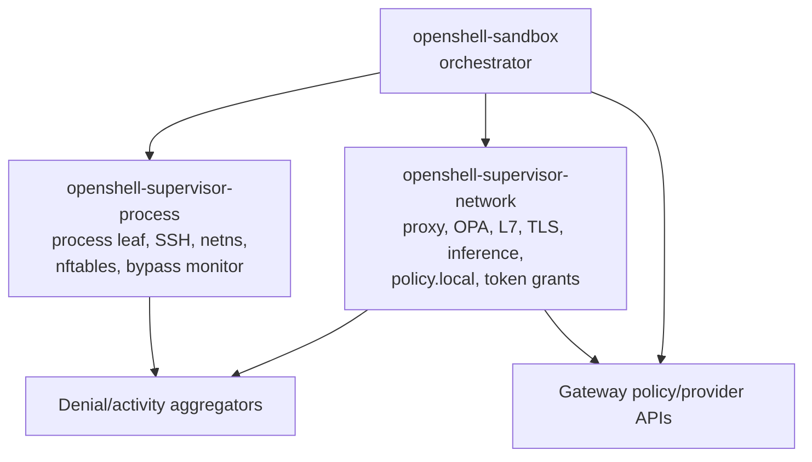
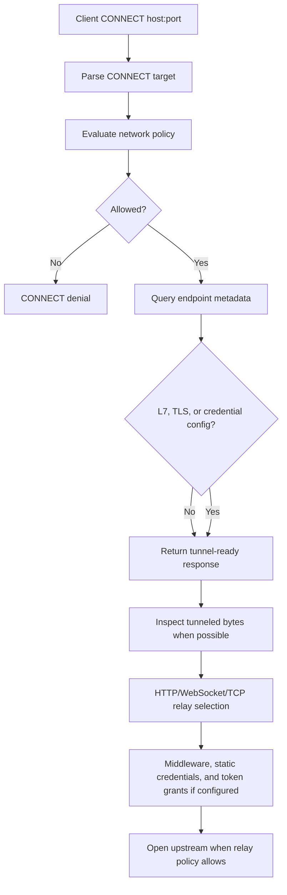
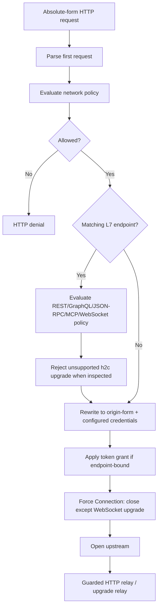
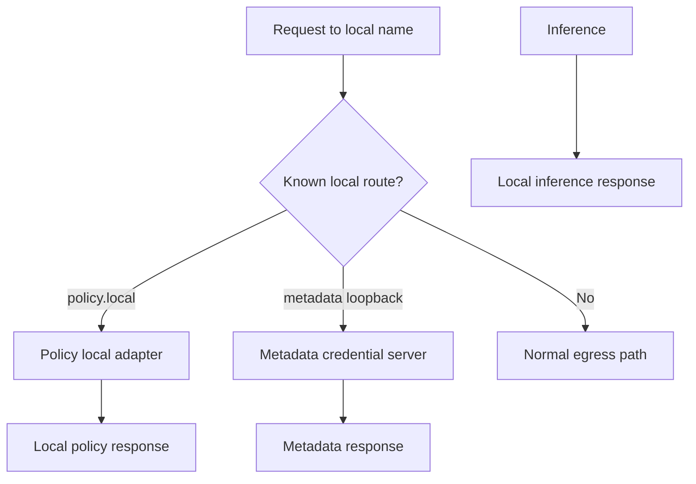
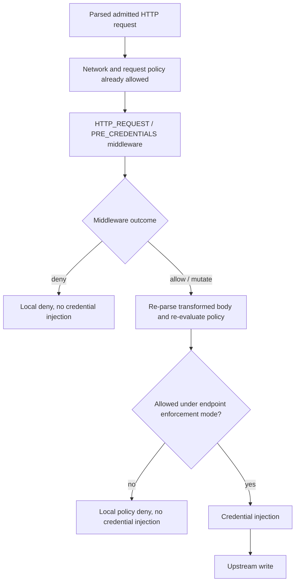
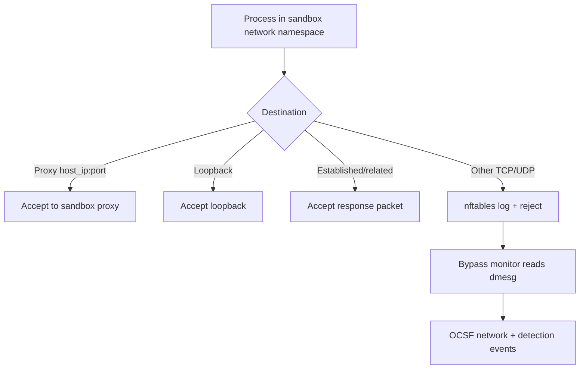

# 当前形态附录

本附录记录当前代理形态，以及促成适配器模型的评审发现。主 RFC 有意将这些细节排除在方向文档之外。

## 当前运行时拆分

代理已不再只是 `openshell-sandbox` 内的一个大模块。当前 main 有三个相关运行时归属方：

`openshell-sandbox` 创建共享网络命名空间，持有拒绝/活动通道，启动策略轮询循环，启动网络，在需要时启动元数据回环服务器，然后可选地启动进程叶子。若 `process_enabled` 为 false，supervisor 可以仅网络模式运行，并保持网络/后台任务存活直到关闭。

`openshell-supervisor-network` 持有显式代理监听器、OPA 引擎集成、L7 强制执行、TLS 终止、推理路由、policy-local 路由、身份缓存、提供商凭据注入和令牌授予。

`openshell-supervisor-process` 持有进程执行、SSH、网络命名空间辅助、nftables 绕过规则，以及将 nftables LOG 条目转为 OCSF 事件的绕过监控器。

在嵌入式 supervisor 模式下，网络叶子通常使用进程/编排器侧解析的进程元数据，用于二进制作用域策略和 OCSF 上下文。当前运行时配置也可改为选择仅端点策略评估。适配器模型必须将这一有意模式与身份查找失败区分开；后者在需要二进制身份时仍继续拒绝。

## 当前面向用户态的接口

网络接口当前包括：

- 用于 HTTPS 和通用 TCP 隧道的 CONNECT 代理流量。
- 用于绝对形式 HTTP 请求的转发 HTTP 代理流量。
- `policy.local`，用于当前策略、拒绝摘要、提案提交和提案等待路由。
- 面向绕过 HTTP 代理变量的 SDK 的 GCE 元数据回环。
- 对不进入代理的直接 TCP/UDP 出口执行 nftables 绕过。
- OPA/Rego 策略和端点元数据查找。
- 用于 CONNECT 和转发 HTTP 出口的 DNS 解析和端点校验。
- 静态提供商凭据注入和脱敏。
- 端点绑定的动态令牌授予注入。
- 可选的 REST 请求体凭据重写。
- L7 REST、GraphQL、JSON-RPC、MCP、WebSocket 和 GraphQL-over-WebSocket 强制执行。

问题不在于这些功能存在，而在于入口机制、策略评估、端点元数据查找、凭据注入和字节中继决策仍然交织在一起。

## 当前 CONNECT 形态

CONNECT 仍是最强的入口形态，因为隧道中继可以在长连接上持续解析 HTTP 请求，并按请求执行策略。

## 当前转发 HTTP 形态

最新 main 对普通转发 HTTP 已不再保留旧的“首个请求后原始复制”形态。它用 `Connection: close` 重写普通请求，使用受保护的 HTTP 中继辅助函数处理请求体，拒绝被检查的 h2c 升级，注入令牌授予，并将允许的 WebSocket 升级送入升级中继。这比历史上的双向复制范围更窄，但仍与 CONNECT 中继路径分开编排。

## 当前本地服务形态

`policy.local` 支持代理式审批循环：代理可提交窄范围提案，并在重试前等待审批/重载。元数据回环用于那些不遵守 HTTP 代理变量的 SDK 所消费的提供商凭据。

这些是面向用户态的网络接口。它们应与外部出口保持区分，同时仍适配适配器模型。

## 相邻的在途 Supervisor 中间件形态

PR #1738 和 #2027 提出将 supervisor 中间件作为代理中继中的 HTTP 请求 Hook。该工作与本 RFC 相邻，而非独立的入口适配器。

拟议的中间件链按已准入的目标主机选择，按确定顺序运行，缓冲有界请求体，应用 `fail_open` 或 `fail_closed`，发出审计安全的发现，并在注入 OpenShell 管理的凭据之前运行。中间件转换后的 GraphQL、JSON-RPC 和 MCP 请求体会在凭据注入或上游写入前重新解析并重新评估，因此变更无法绕过请求策略。策略不匹配保留端点的审计或强制执行行为，而格式错误的转换后协议请求体在两种模式下均失败关闭。中间件可以检查 WebSocket 升级请求，因为它们是 HTTP 请求，但在 v1 中不检查升级后的 WebSocket 帧。

RFC 0005 应通过将中间件视为共享请求处理计划的一部分来考虑这一点。CONNECT 和转发 HTTP 不应各自独立学习如何选择和调用中间件。

## 当前网络命名空间强制执行

进程叶子安装 `inet` nftables 过滤表用于绕过强制执行。该表接受代理绑定流量、回环和已建立流，然后拒绝并可选记录其他 TCP/UDP 流量。它当前不会将原生 TCP 连接重定向到代理。

## 需保留的发现

### 不变量：转发代理不得中继未评估的后续 HTTP 字节

历史转发路径最多评估第一个绝对形式请求，重写它，然后切换为双向复制。首个头部块之后已缓冲的字节，或同一客户端/上游连接上后续流水线请求，可能到达上游而未经 CONNECT L7 中继的逐请求解析器/评估器。

最新 main 通过强制普通转发 HTTP 每连接一个请求并使用受保护的中继辅助函数来缓解此问题。适配器模型应通过保持转发 HTTP 单请求/关闭，或将首个解析请求传入共享 HTTP 中继循环来保留该不变量。

### 端点配置未绑定到确定性匹配策略

用于 L4 授权和日志的策略名是字典序最小的匹配策略。L7 候选独立收集，随后按请求路径特异性选择。TLS 和 `allowed_ips` 使用单独查询返回的第一个扩展端点配置。精确声明主机是另一个独立的存在性查询。当主机、端口和二进制规则重叠时，这些结果可能在同一连接上描述不同的端点和策略。

适配器模型要求授权返回一个决策，并附带一个确定性匹配端点。

### 策略物化可能跨代

L4 决策、L7 路由、TLS 模式、`allowed_ips` 和精确声明主机信号通过独立的引擎调用物化。L7 路由为其隧道评估器记录一个代，但同级元数据查询并未全部针对 L4 决策代进行断言。因此，设置期间的重载可能从不同策略代组装一个逻辑连接决策。

目标决策携带一个顶层策略代。每个策略派生字段都必须从该代评估，中继启动必须在上游请求写入前拒绝过期决策。

### 端点元数据查询失败不应抹除强制执行

当前失败行为不统一。L7 配置失败变为无 L7 配置，TLS 配置失败变为自动 TLS 处理；两者都可能抹除预期的强制执行。`allowed_ips` 和下游 SSRF 校验路径已更保守。迁移必须独立测试每个查询，而不是将所有元数据失败描述为等价。

适配器模型将端点元数据视为授权结果的一部分。无法物化所需元数据应拒绝，而非抹除扩展配置。

### 目标校验必须共享

私有地址检查、`allowed_ips`、精确声明的私有端点信任、受信网关别名、SSRF 检查和控制平面端口阻止随时间增长。它们应集中化，使 CONNECT 和转发 HTTP 使用相同的解析目标规则。现有本地服务仍处于正常外部目标校验之外。

## 现有功能清单

重构应保留：

- CONNECT 显式代理支持。
- 转发 HTTP 显式代理支持。
- 仅网络 supervisor 模式。
- nftables 绕过拒绝/日志强制执行。
- 提供商凭据注入和脱敏。
- 通过 SPIFFE 支持的提供商凭据进行动态令牌授予注入。
- supervisor 中间件 `HTTP_REQUEST / PRE_CREDENTIALS`（落地后）。
- REST 请求体凭据重写。
- WebSocket 文本帧凭据重写。
- REST 端点方法/路径策略。
- GraphQL-over-HTTP 策略。
- JSON-RPC-over-HTTP 方法策略。
- MCP Streamable HTTP 方法和工具策略。
- WebSocket 传输和 GraphQL-over-WebSocket 策略。
- 被检查 HTTP 路由上的 h2c 拒绝。
- 面向代理的通过 `policy.local` 的策略顾问路由。
- 面向受支持提供商凭据的 GCE 元数据回环。
- 客户端、上游和本地服务工作的超时与资源跟踪。
- 网络和 HTTP 策略结果的结构化 OCSF 日志。
- SSRF 和内部地址保护。
- 精确声明的私有端点处理。
- 控制平面端口保护。
- `allowed_ips` 端点限制。
- 对可检查客户端连接的 TLS 自动检测和终止。