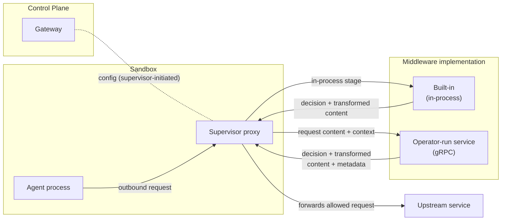
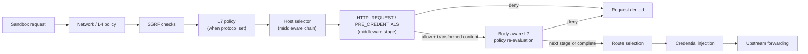

---
authors:
  - "@pimlock"
state: accepted
links:
  - https://github.com/NVIDIA/OpenShell/issues/1043
  - https://github.com/NVIDIA/OpenShell/issues/1733
  - https://github.com/NVIDIA/OpenShell/issues/1734
  - https://github.com/NVIDIA/OpenShell/issues/1919
  - https://github.com/NVIDIA/OpenShell/issues/2010
  - https://github.com/NVIDIA/OpenShell/pull/2027
---

# RFC 0009 - Supervisor 中间件

## 修订历史

| 日期 | 参考 | 变更 |
|------|------------|--------|
| 2026-07-17 | [#2010](https://github.com/NVIDIA/OpenShell/issues/2010) | 新增一元 HTTP 请求中间件，包含内置服务和运维方运行的服务。 |
| 2026-07-28 | [#2428](https://github.com/NVIDIA/OpenShell/issues/2428) | 新增 WebSocket 预检和文本消息评估，并对齐中间件 API 名称、限制和诊断信息。 |

## 摘要

本 RFC 提出引入 supervisor 中间件：一套 supervisor 侧的扩展系统，用于在特定操作阶段检查、转换、阻断和标注 supervisor 管理的操作。首个 Hook 族是 supervisor 出站中间件，用于沙箱发出的 HTTP 请求；但框架的命名和形态刻意保持通用，以便后续 supervisor Hook 覆盖其他协议或 supervisor 操作时无需重命名该功能。

## 动机

OpenShell 已经控制了沙箱可以连接到*哪里*。supervisor 对每条出站连接执行网络策略，只允许出站到已批准的端点。目前，这种控制止步于目的地：一旦连接被允许，请求可以携带任意载荷。网络策略可以决定沙箱能否访问 `api.openai.com`，但无法根据请求内容决定某个发往 `api.openai.com` 的请求是否应被允许。

用户需要控制离开沙箱的内容。Agent 经常发送提示词、工具参数、上传文件，其中可能包含敏感信息。要处理这些流量，需要检查请求本身（例如在离开沙箱前脱敏 PII 或密钥、阻断携带机密文档的请求、要求敏感内容由本地模型处理）。

本 RFC 引入 supervisor 中间件及其首个 Hook 族——supervisor 出站中间件：在 supervisor 代理流程中运行的 Hook，可根据内容检查、转换、阻断和标注出站请求。OpenShell 不内置固定的内容检查集合，而是通过中间件契约让运维方将选定请求交给实现自有逻辑的可信服务处理。OpenShell 无法内置所有有用的检测和转换方法。我们希望让 Presidio 或 NeMo Anonymizer 等专用 PII 工具、组织特定的分类器以及实验性研究扫描器都能接入。稳定的契约让团队和研究者可以迭代不同实现，而无需修改 OpenShell 本身。

OpenShell 仍可能为少数合适的操作提供第一方中间件。第一方中间件尽可能使用相同的请求处理模型，但受限 Hook 可能暴露外部中间件永远无法获得的 supervisor 专属主机能力。

### 用例：Privacy Guard

Privacy Guard 是本 RFC 的动机用例。它是一种中间件，检查出站请求内容中的敏感数据，并在请求离开沙箱前采取缓解措施。我们在本文档中始终以它作为具体示例，因为它涵盖了契约所需的每一项属性：策略控制的代理流程位置、外部服务配置、请求/响应契约、失败行为以及审计安全的发现结果。

考虑一个配置了云模型的 Agent。运维方希望上传的图片永远不到达该模型。通过 supervisor 中间件，他们在发往模型端点的请求上配置 Privacy Guard。当 Agent 上传图片并就此询问模型时，中间件检查请求内容，检测到图片并将其脱敏——在请求离开沙箱前替换为占位符（例如 `image upload is disabled for this model`）。

除脱敏外，中间件还会生成关于请求的结构化发现结果和字符串元数据。该元数据在 v1 中仅是标注面；模型路由工作将在后续定义任何路由级别的类型化契约。

## 非目标

- **模型路由。** 本 RFC 定义了中间件可发出的 v1 字符串元数据，但不定义消费发现结果或元数据来选择模型的组件。根据发现结果将请求路由到不同模型是独立关注点，跟踪于 [#1734](https://github.com/NVIDIA/OpenShell/issues/1734)。这里仅避免阻碍未来的路由契约：v1 中间件决策保持 `allow`/`deny`，任何后续路由选择 Hook 应限于 OpenShell 管理的路由，而非从一个外部端点任意重写到另一个。
- **通用 OpenShell 插件框架。** 第一版针对 supervisor 拥有的请求处理，从 supervisor 代理流程中的出站 HTTP 请求开始。它不是覆盖 OpenShell 每个扩展点的任意插件系统，也不涵盖网关控制平面 Hook、计算驱动行为或非 supervisor 扩展点。
- **约束或沙箱化中间件本身。** 中间件获得请求内容的原始访问权限。OpenShell 将载荷路由到运维方选择信任的服务；它不沙箱化中间件、不验证其行为，也不阻止恶意中间件错误处理其检查的数据。认证加密传输保护连接，但不使服务变得可信。更强的服务隔离（例如在自有沙箱中运行中间件）留作后续工作。
- **中间件的运行时管理。** 中间件在网关配置中声明。用于添加、列出或验证中间件的运行时 CLI 或 API——以及简化注册的易用工具（如专用命令或用于脚手架和注册新服务的 Agent 技能）——推迟到契约稳定后的后续工作。
- **保证检测正确性。** OpenShell 放置 Hook 并执行中间件返回的决策，但不保证中间件实际捕获所有敏感内容。检测质量是中间件的责任。
- **支持所有部署模式。** 第一版支持进程内内置和静态注册的外部中间件服务。其他形态如 WASM 中间件、OpenShell 管理的镜像、sidecar 以及在自有沙箱中运行中间件不在本 RFC 设计中。它们明确留待后续评估，而非固化到初始契约中。参见 [appendices/deployment-options.md](appendices/deployment-options.md)。

## 术语

本 RFC 使用以下术语，具有特定含义。

- **出站（Egress）。** 沙箱通过 supervisor 代理发往上游目的地的出站请求。v1 中间件 Hook 作用于 supervisor 已准入并即将转发的已解析请求，而非原始数据包或任意网络活动。
- **中间件（Middleware）。** 通过本 RFC 定义的契约检查、转换、阻断或标注 supervisor 操作的服务。在 v1 出站 Hook 中，中间件拥有其检测和转换逻辑，且从不自行发起上游调用；上游调用始终由 supervisor 拥有。
- **已注册中间件（Registered middleware）。** 运维方在网关配置中声明的外部中间件服务，由诊断名称加 gRPC 端点组成。注册是管理操作，确立哪些端点可以接收原始请求内容。服务通过 `Describe` 暴露稳定的绑定 ID，策略引用这些绑定 ID 而非注册名称。
- **内置中间件（Built-in middleware）。** 随 supervisor 二进制发布并在进程内运行的中间件，无网络跳转、无网关注册。内置绑定 ID 使用保留的 `openshell/` 命名空间，例如 `openshell/regex`。
- **操作（Operation）。** 标识 OpenShell 调用中间件位置的类型化方法加类型化阶段。本 RFC 的 v1 中间件评估 `method=HTTP_REQUEST, phase=PRE_CREDENTIALS`。
- **Hook。** 针对一个操作的具名中间件 API 契约。中间件 Hook 名称是中间件 API 的一部分，而非调用方提供的任意字符串。v1 Hook 是 `HTTP_REQUEST/PRE_CREDENTIALS`，在 HTTP 中继中运行，此时请求已被解析并由策略准入，且在凭证注入之前。设计允许后续添加更多类型化操作，而不改变 v1 Hook 的请求形态。
- **评估（Evaluation）。** 针对特定操作、请求上下文、有界正文和中间件配置对中间件的一次调用。中间件保留 `EvaluateHttpRequest` 等操作特定方法，因为输入和输出因协议或操作类型而异。
- **结果（Result）。** 对评估的响应。对于 v1 HTTP 请求 Hook，结果携带允许/拒绝决策、可选替换内容和安全的头部变更、发现结果、元数据以及安全错误信息。
- **中间件配置（Middleware config）。** 存储在稳定策略本地映射键下的策略条目，用于命名空间化元数据和诊断信息。可选的 `name` 字段是人类可读标签，默认为映射键。`middleware` 字段将条目绑定到服务拥有的绑定 ID，其余字段定义服务特定配置、端点选择器、失败行为和排序。
- **清单（Manifest）。** 中间件从 `Describe` 返回的自描述：其服务版本及其支持 Hook 的服务拥有绑定。protobuf 包 `openshell.middleware.v1` 定义线缆版本边界；请求和清单不携带重复的 API 版本字符串。
- **决策（Decision）。** 中间件对请求返回的允许或拒绝结果。`allow` 让请求继续（可能被转换）；`deny` 短路请求。该词汇与 OpenShell 策略系统其余部分一致。
- **失败策略（Failure policy）。** 中间件无法返回有效结果时配置的 `on_error` 行为：`fail_closed` 拒绝请求，`fail_open` 在没有该中间件转换的情况下让请求继续，同时记录执行失败。当处理是必需时，`fail_closed` 是默认值。
- **转换（Transformation）。** 中间件返回替换内容及任何允许的头部变更，supervisor 以此替代原始请求转发。链中后续中间件看到前一阶段转换后的内容。
- **发现结果（Finding）。** 中间件报告的关于请求的结构化、审计安全的观察，如机器可读类型、安全标签、计数、置信度和可选严重性。发现结果从不携带原始匹配值、脱敏区间或原始敏感内容。supervisor 将发现结果映射为 OCSF `DetectionFinding` 事件。
- **元数据（Metadata）。** 中间件发出到请求本地袋中的命名空间化字符串键/值标注。V1 元数据从不携带原始敏感值。路由级别的类型化元数据（包括审计安全、路由安全或仅内部等使用标记）推迟到有组件消费时。
- **链（Chain）。** 适用于单个请求的有序中间件配置集合。每个配置依次运行，后续阶段看到前一阶段转换后的内容，`deny` 短路剩余阶段，每个匹配配置每请求最多运行一次。

## 提案

第一版通过一个出站 Hook 族使 supervisor 中间件具体化，而不过早标准化所有未来部署模型。它支持在 supervisor 内运行的第一方内置和运维方运行并静态注册的外部服务。OpenShell 将选定的出站流量路由通过结果链，每个阶段返回决策及可选转换内容、发现结果和元数据。这使第一轮迭代聚焦于契约、失败行为和沙箱集成，同时保持其他部署形态开放（参见 [appendices/deployment-options.md](appendices/deployment-options.md)）。

外部中间件服务通过 gRPC 网络端点暴露。稳定契约要求认证加密传输；仅阶段 1 可明确选择明文，用于可信本地或隔离研究环境，阶段 2 移除该例外。参见 [appendices/protocol-extensions.md](appendices/protocol-extensions.md#middleware-authentication)。

### 架构

三个组件参与：

- **网关（控制平面）。** 注册中间件，验证每个注册服务支持引用它的策略，并将有效中间件配置分发到 supervisor。网关从不看到实时请求正文；它不在热路径上。
- **Supervisor 代理（数据平面）。** 在请求热路径上调用中间件，执行返回的决策，仅转发中间件返回的内容，并向前携带发出的元数据。supervisor 拥有上游调用。
- **中间件实现。** 检查请求并返回决策、可选转换内容、发现结果和元数据。中间件可以是安装在进程内的第一方内置，也可以是通过 gRPC 访问的运维方运行服务。两者使用相同的链和结果语义，且从不发起上游调用。受限内置可访问外部服务不可用的 supervisor 专属能力。

### 操作阶段与位置

中间件服务提供 Hook 实现，supervisor 在代理流程中定义的操作阶段调用它们。本版本定义单个类型化中间件操作 `HTTP_REQUEST/PRE_CREDENTIALS`，并结构化以便后续添加更多操作。supervisor 在 HTTP 中继中调用该 Hook，此时请求已被解析并由策略准入，且在 OpenShell 注入上游凭证之前。

该顺序是刻意的：

- 网络策略（以及端点声明 `protocol` 时的 L7 策略）先运行，因此 OpenShell 从不将已被拒绝的流量发送到中间件服务。
- 中间件选择使用已准入的请求主机，与哪个用户、提供方或合并网络规则准入请求无关。这为有效策略在策略组合后提供单一稳定的选择模型。
- 中间件在凭证注入前运行，因此中间件从不接收 OpenShell 管理的上游凭证。
- 阶段替换请求正文后，OpenShell 在调用下一阶段或转发上游前重新评估正文感知的 GraphQL、JSON-RPC 或 MCP 策略。策略评估错误或无法解析的替换是硬拒绝。强制策略拒绝会停止并拒绝。在审计模式下，OpenShell 记录拒绝、停止剩余中间件链并转发转换后的请求。
- 中间件的显式拒绝和 `fail_closed` 行为本身是执行决策，即使网络端点使用 `enforcement: audit` 也保持阻断。
- 路由选择——选择哪个上游、未来选择哪个模型来服务请求——在 Hook 之后运行，因此后续模型路由工作对任何中间件发现结果或元数据有清晰的交接点。v1 中没有模型路由器；此框标记未来插入位置。中间件不自行转发流量，v1 刻意没有 `forward_to` 决策。任何后续路由选择阶段应返回 OpenShell 拥有的受管目的地路由决策，而非从一个外部端点任意重写到另一个。
- 上游调用始终由 supervisor 拥有，而非中间件。

Hook 作用于已解析的 HTTP 请求，因此在 OpenShell 能解析请求的地方运行。supervisor 代理对每条未标记 `tls: skip` 且非不透明非 HTTP 流量的出站连接进行 TLS 终止和 HTTP 解析，因此无论端点是否声明 `protocol`，Hook 都会在这些请求上触发。声明 `protocol` 还会使请求受 L7 Rego 策略约束；没有声明的端点仍被终止和解析，中间件 Hook 仍在其上运行。Hook 无法检查的唯一流量是 OpenShell 从不解析的流量：`tls: skip` 端点和不透明 TCP 或 TLS 直通。策略验证拒绝任何可能主机与配置了 `tls: skip` 的端点重叠的中间件选择器，因此基于选择器的中间件不会被未解析路径静默绕过。

> **PR #2477 更新 - WebSocket 中间件：** 以下文本扩展了原始仅 HTTP 的范围。它增加了操作特定选择、客户端 WebSocket 文本消息检查，以及对已附加中间件无法检查的流量的明确覆盖。

如果选定的操作链在运行时变得不可检查，OpenShell 检查该链。如果任何选定阶段是 `fail_closed`，请求被拒绝。如果每个选定阶段都是 `fail_open`，OpenShell 中继请求并发出绕过 `DetectionFinding`。此链级规则防止一个宽松的选定阶段覆盖必需阶段。

附加和操作选择是分开的。目的地主机选择器附加策略配置，然后实现清单决定该配置是否参与 `HTTP_REQUEST/PRE_CREDENTIALS`、`WEBSOCKET_MESSAGE/PRE_CREDENTIALS` 或两者。缺少操作绑定是声明的能力边界而非中间件失败，因此 `on_error` 不适用。当附加配置未加入 WebSocket 链时，OpenShell 记录信息性覆盖。

WebSocket 位于此边界上。升级请求是普通 HTTP/1.1 请求，HTTP 绑定可以检查、允许或拒绝。单独的 V1 操作覆盖升级后完整的客户端到上游文本消息。二进制消息、控制帧和上游到客户端消息不在该操作范围内。为保持 v1 边界明确：

**v1 范围内：**

- OpenShell 终止并解析的可检查 HTTP/1.x 请求，在 L4 和 SSRF 准入后（以及端点声明 `protocol` 时的 L7 策略）。
- WebSocket 升级（握手）请求——发起升级的 HTTP 请求。
- 对于声明 `WEBSOCKET_MESSAGE/PRE_CREDENTIALS` 的实现，完整的客户端到上游 WebSocket 文本消息。
- 有界请求正文：OpenShell 可在适用链上限内缓冲的 `Content-Length` 或有界分块