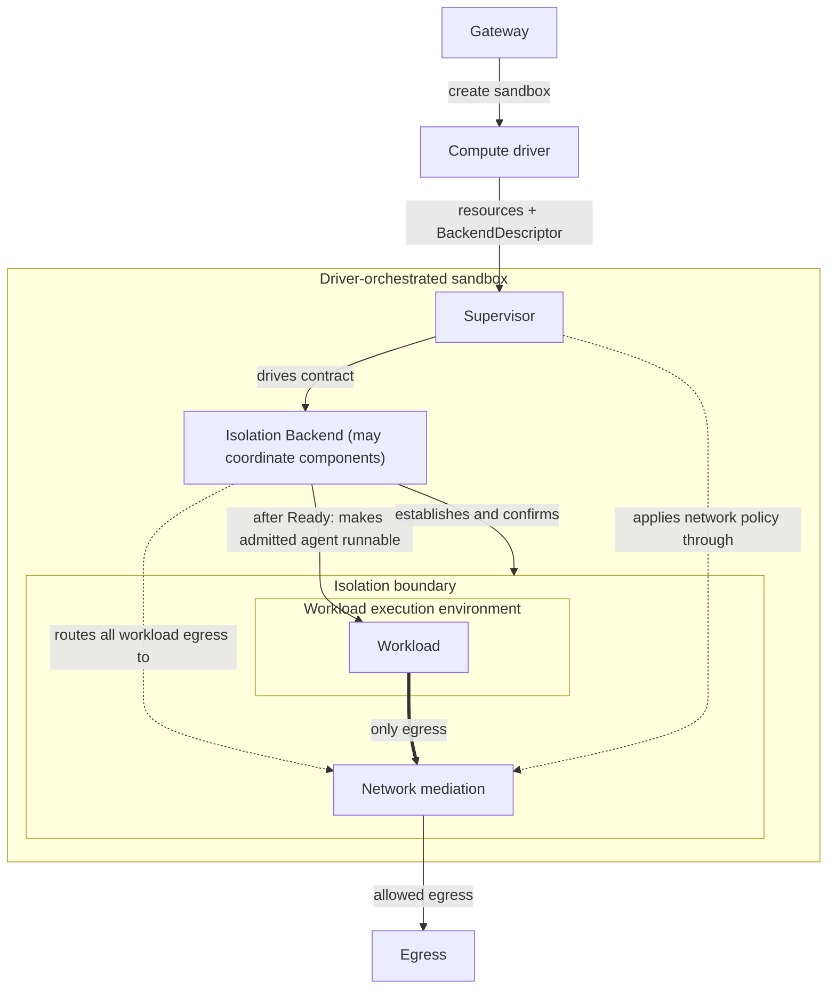

---
authors:
  - "@jganoff"
state: review
links:
  - https://github.com/NVIDIA/OpenShell/issues/1737
  - https://github.com/NVIDIA/OpenShell/pull/2048
  - https://github.com/NVIDIA/OpenShell/issues/899
  - https://github.com/NVIDIA/OpenShell/issues/981
  - https://github.com/NVIDIA/OpenShell/issues/1511
  - https://github.com/NVIDIA/OpenShell/issues/1650
  - https://github.com/NVIDIA/OpenShell/issues/1680
  - https://github.com/NVIDIA/OpenShell/pull/2606
---

# RFC 0012 - 隔离后端接口

## 摘要

目前，supervisor 既构建工作负载的隔离边界，又应用其网络策略。由于 supervisor 运行在 agent 容器内，构建该边界所需的特权与其所约束的代码位于同一处。本 RFC 将边界构建和进程操作移至可插拔的**隔离后端**之后。supervisor 继续通过网络中介应用已批准的网络策略。

计算驱动负责编排工作负载、supervisor、沙箱运行时、受保护通道和外部网络围栏。supervisor 是网关与工作负载之间受信任的桥梁：它维护网关连接、处理已授权请求并驱动后端。后端建立隔离控制、管理工作负载进程，并将出站流量路由至网络中介。同一生命周期支持不同的计算驱动和后端实现，无需驱动特定的 supervisor 路径。

实现通过
[`isolation_backend.proto`](../../proto/isolation_backend.proto) 和
[`sandbox_protocol.proto`](../../proto/sandbox_protocol.proto) 表达此契约。下方的 Rust
签名用于说明生命周期模型；它们不是后端扩展 trait。supervisor 使用具体的 RPC 客户端，后端实现生成的服务。线上协商和消息定义位于 proto 中。

## 动机

边界构建嵌入在 supervisor 中，因此将其移至其他位置意味着修改 supervisor。这种放置方式带来三个问题：

- 一旦被攻破，攻击者可在同一容器内触及边界构建特权。
- 在 agent 容器内构建边界所需的能力与受限部署相冲突。委托构建可消除该要求，但不保证符合 Pod Security Standards。背景见 #899。
- 每种新的放置方式都会给 supervisor 增加一个分支。

这三个问题都源于将边界构建与边界操作耦合。一个通用接口可让部署在不修改 supervisor 的情况下移动特权。

## 非目标

- **实现委托后端。** 每个后端实现和计算驱动放置都需要各自的设计与实现。
- **更改授权。** [RFC 0001](../0001-core-architecture/README.md) 负责控制平面和沙箱身份。委托后端仍必须认证调用方并将其限定在单个边界内。
- **标准化后端内部组件协调。** 后端可在同一生命周期后协调辅助进程、sidecar 或拦截进程；这些组件如何协作属于后端特定，不属于契约表面。
- **更改网关生命周期或公开状态。** 本 RFC 不新增网关激活操作、公开阶段或状态 API，也不定义如何向运维人员呈现边界的有效隔离模型。

## 提案

心智模型包含三个角色：

- **计算驱动**编排沙箱实例：放置工作负载、supervisor 和沙箱运行时；创建其受保护通道；并应用外部网络围栏。
- **隔离后端**建立并操作工作负载周围的控制。它还将工作负载出站流量路由至网络中介，并提供进程操作。
- **逻辑 supervisor** 是网关与工作负载之间受信任的控制平面桥梁。它驱动后端、处理已授权的网关请求，并通过网络中介应用已批准的网络策略。

网络策略、文件系统隔离、系统调用过滤和沙箱身份共同构成工作负载的隔离边界。上述角色执行该边界，可运行在一个进程或跨多个受信任组件。其放置方式不改变契约。

每个活动边界至多有一个逻辑 supervisor，可跨多个耦合进程。后端将所有工作负载出站流量通过每边界来源路由，supervisor 消费该来源。内部委托和传输保持后端私有。

[RFC 0001](../0001-core-architecture/README.md) 继续负责沙箱认证和授权。在本契约中，沙箱身份意味着将已认证的沙箱上下文绑定到隔离边界。

准入选择沙箱的隔离后端并确定其受信任上下文。计算驱动编排所需资源，并向 supervisor 提供描述所选后端和已配置运行时的 `BackendDescriptor`。supervisor 使用该描述符附加匹配的隔离后端。后端在 agent 启动前准备所需控制。



初始实现为 `OpenShellRuntimeBackend`：一个 supervisor 侧客户端，通过已认证的 OpenShell Sandbox Protocol 将操作委托给工作负载旁的 `openshell-sandbox`。其他后端使用各自的隔离机制实现相同的 RPC 服务；它们不需要 `openshell-sandbox` 二进制。

边界从成功的 `attach` 开始处于活动状态，直到正常后端清理释放绑定，或计算驱动的受信任清理路径使其失效。后端可为该边界协调多个受信任辅助或拦截进程。后端拥有活动边界绑定；计算驱动拥有沙箱实例和基础设施生命周期。

### 契约不变量

每个边界都遵循六条不变量：

1. 在边界生命周期内，除通过网络中介外，工作负载出站流量一律拒绝。
2. 在适用于该进程的所有已准入控制生效之前，不执行任何不受信任的指令。
3. 仅当完整有效策略允许时，操作才被授权；网络操作通过网络中介决定。不存在静默削弱。
4. Agent 启动、`exec` 和转发仅通过活动后端进行，每个工作负载进程都保持在计算驱动配置的执行环境中。
5. 共享基础设施保持严格的每边界生命周期、策略、身份、执行和清理隔离。
6. 如果逻辑 supervisor 或其传输丢失，执行保持生效，依赖 supervisor 的操作失败关闭。后端可终止、暂停或保持工作负载受控。网络中介不可用会拒绝出站连接，绝不启用直接出站。如果无法维持所需执行，后端或受信任的节点或控制平面角色在文档化时限内停止工作负载执行。运行时退出不得留下工作负载在缺少所需执行的情况下运行；终止工作负载是满足此要求的一种后端特定方式。

每个后端记录其在 supervisor 或运行时丢失时的行为，以及在无法维持执行时停止执行的时限。逻辑 supervisor 丢失意味着持有后端生命周期的组件丢失，而非网关连接丢失；网关断开遵循 RFC 0001 的重连语义。

传输恢复限定于同一逻辑 supervisor 进程。后端可重连该进程并重新确认其绑定，但替换的 supervisor 进程无法使用启动凭据恢复现有运行时世代。计划升级会停止沙箱并启动新世代。

### 配置

配置在控制平面上运行，每个沙箱遵循三条规则：

1. **准入从受信任部署配置中选择隔离后端**，而非 `SandboxPolicy`。计算驱动提供的 `BackendDescriptor` 必须指明该后端，解析绝不回退到其他后端。
2. **计算驱动编排沙箱**及所选后端所需的任何内容。
3. **后端在不受信任代码运行前建立常驻执行**，在配置或 `attach` 期间进行，具体取决于后端。

如果驱动依赖集群范围覆盖或注册，准入在不受信任代码运行前验证前提条件覆盖边界的放置位置。

每个计算驱动提供不依赖 supervisor 可用性的受信任清理路径。

计算驱动可在控制平面将资源分配给沙箱之前配置资源和 `BackendDescriptor`。资源未分配时，不运行任何不受信任工作负载。在认领或分配产生受信任的 `SandboxContext` 后，supervisor 调用 `attach`；后端要么将该上下文绑定到已准备资源并返回 `Bound`，要么以不兼容为由拒绝。池创建、认领、重置、释放和回收不在本契约范围内。

每次创建或从停止状态启动的操作都会获得新的 `SandboxSessionId`。同一持久启动转换的重试复用该身份，而后续启动获得新身份，即使计算平台复用其外部资源。后端将 `attach` 绑定到该确切会话，并拒绝来自早期启动的描述符或运行时会话。

### 后端描述符

驱动为每个已配置沙箱提供描述符，包括分配前准备的资源。通用信封指明后端名称并携带不透明载荷。

```rust
struct BackendDescriptor {
    backend_name: String,
    version: u32,
    payload: Vec<u8>,
}
```

`version` 是隔离后端接口版本。后端名称和版本必须精确匹配；本契约不协商兼容范围。描述符与传输无关。配置在 `attach` 前将其提供给 supervisor；传输方式属于计算驱动特定，不在本契约范围内，且每种传输都保持一个属性：工作负载控制的输入不能选择或修改描述符。

不透明载荷标识或为后端提供足够信息以解析确切的驱动配置资源。它还可携带后端特定的端点或辅助角色信息；没有通用的放置或角色字段。

通用验证要求：

- 描述符的 `backend_name` 与准入期间选择的后端匹配；
- 描述符的版本是 supervisor 支持的版本，且解析的后端报告相同版本；以及
- `SandboxContext` 在控制平面将资源分配给已准入沙箱后，使用已认证的控制平面和受信任 supervisor 状态构建。

supervisor 验证描述符的通用字段并生成 `VerifiedBackendDescriptor`，然后无回退地解析其 `backend_name` 和版本。验证不意味着不透明载荷有效；所选后端在 `attach` 期间验证它并将已配置资源原子绑定到受信任的 `SandboxContext`。任何失败都会拒绝沙箱。

### 生命周期

契约不规定执行机制；它标准化 supervisor 如何驱动部署所准入的任何后端。

后端以 `backend_name` 和版本注册。supervisor 附加到已准入沙箱，并通过固定状态序列驱动边界。每次转换消耗前一状态，因此 supervisor 不能跳过阶段或通过早期句柄调用后续转换。Rust 名称仅为示意；状态及其语义是规范性的。

```text
attach backend descriptor + sandbox context -> Bound -> confirm -> Ready -> start_agent -> Running
```

```rust
#[async_trait]
trait IsolationBackend: Send + Sync {
    fn backend_name(&self) -> &str;
    fn version(&self) -> u32;

    async fn attach(
        &self,
        descriptor: VerifiedBackendDescriptor,
        sandbox: SandboxContext,
    ) -> Result<Box<dyn BoundBoundary>, BackendError>;
}

struct SandboxContext {
    sandbox_id: SandboxId,
    session_id: SandboxSessionId,
    policy: SandboxPolicy,
    agent: AgentSpec,
}

#[async_trait]
trait BoundBoundary: Send {
    fn network_mediation_source(&self) -> Arc<dyn NetworkMediationSource>;

    async fn confirm(
        self: Box<Self>,
    ) -> Result<Box<dyn ReadyBoundary>, BackendError>;
}

#[async_trait]
trait ReadyBoundary: Send {
    async fn start_agent(
        self: Box<Self>,
    ) -> Result<Box<dyn RunningBoundary>, BackendError>;
}

#[async_trait]
trait RunningBoundary: Send + Sync {
    fn agent(&self) -> Arc<dyn BoundaryProcess>;
    fn exec(&self) -> Arc<dyn BoundaryExec>;
    fn loopback_connector(&self) -> Arc<dyn BoundaryLoopbackConnector>;
}
```

`AgentSpec` 携带完整的已准入 agent 启动规范，包括命令、参数、工作目录、超时和交互模式。

`SandboxContext` 携带已准入的创建时策略和本次启动的身份。[RFC 0002](../0002-agent-driven-policy-management/README.md) 定义网络策略修订的提议和批准方式。已批准的修订通过现有 [`GetSandboxConfig`](../../proto/sandbox.proto) 网关-supervisor 契约到达 supervisor。supervisor 通过网络中介使已批准的网络策略修订生效。如果已批准的网络策略修订无法加载，它绝不生效；配置的拒绝姿态保留最后有效世代或拒绝网络访问，直到加载有效世代。

状态具有规范性含义：

- **Bound：** 后端描述符和受信任沙箱上下文绑定到同一资源，且网络中介来源可用。没有不受信任的工作负载代码运行。
- **Ready：** 后端已确认此具体边界的常驻执行，并准备在不受信任执行前应用已准入的启动时控制。
- **Running：** `start_agent` 已使已准入 agent 可运行并返回 `RunningBoundary`。所有适用的启动时控制在第一条不受信任指令前已生效。后端是创建 agent 进程还是释放持有的、驱动配置的执行对象属于后端特定；契约固定顺序，而非机制。

`confirm` 是启动前提交点。supervisor 仅在将边界的网络中介来源连接到网络中介后调用它。后端确认具体边界的常驻执行，可依赖与该边界放置相关的受信任配置时或 Pod 外信号，但不能仅依赖一般放置健康状态。

`attach` 拒绝已绑定到活动边界的资源。无法执行完整已准入策略的边界不会到达 `Ready`：后端使 `attach` 或 `confirm` 失败，或 supervisor 使网络中介初始化失败。

成功的 `confirm` 断言这些要求；它不返回通用机制清单或保证标志。认证、启动绑定、策略决策的受信任身份以及防止未中介出站是强制性的。文件系统和特权控制取决于已准入策略和后端的执行模型。没有文件系统 API 的隔离环境无需实现 Linux 文件系统控制。不支持的要求在工作负载执行前被拒绝；绝不静默忽略。

[`sandbox_protocol.proto`](../../proto/sandbox_protocol.proto) 中的 protobuf 表示返回世代、会话、已准入工作负载身份、资源声明，以及绑定到该世代的驱动已验证配置证据的摘要。客户端将这些与受信任启动元数据比较。摘要保留配置绑定；它不是执行的独立证明。后端特定审计数据在线上是可选的。原生 Linux 客户端继续要求并验证其测量的审计证据。

**常驻执行**独立于工作负载进程建立。**启动时控制**必须在进程执行第一条不受信任指令前生效。`start_agent` 和 `BoundaryExec::exec` 都执行此顺序并保留已配置的执行环境。

`start_agent` 是唯一可使已准入 agent 可运行的操作。后端可创建或释放进程，但工作负载控制的代码不能在 `start_agent` 应用所需控制之前运行。

`RunningBoundary::agent()` 返回已准入 agent 进程的句柄。通过 `BoundaryExec` 启动的进程在同一边界中运行并拥有自己的进程句柄。每个工作负载进程都保持在已配置的执行环境中。已准入 agent 的任何退出都会结束 `Running`；后端随后终止该环境中所有剩余工作负载进程，并拒绝进一步的运行时操作，但下文定义的 `wait` 除外。

### 运行时操作

```rust
#[async_trait]
trait BoundaryProcess: Send + Sync {  // the agent, or a process started via exec
    async fn wait(&self) -> Result<BoundaryExitStatus, BackendError>; // one stable result where process-exit observation is retained
    async fn signal(&self, signal: BoundarySignal) -> Result<(), BackendError>;
    async fn terminate(&self) -> Result<(), BackendError>;            // this process and its descendants
}

#[async_trait]
trait BoundaryExec: Send + Sync {
    async fn exec(&self, spec: ExecSpec) -> Result<ExecSession, BackendError>;
}

struct ExecSession {                              // owned; outlives the exec call
    process: Arc<dyn BoundaryProcess>,
    stdin: Option<BoundaryInput>,
    stdout: BoundaryOutput,                       // distinct from stderr for non-PTY exec
    stderr: Option<BoundaryOutput>,
    terminal: Option<Arc<dyn BoundaryTerminal>>,  // present when a PTY was requested
}

#[async_trait]
trait BoundaryLoopbackConnector: Send + Sync {
    async fn connect(&self, target: LoopbackTarget) -> Result<BoundaryDuplexStream, BackendError>;
}

#[async_trait]
trait BoundaryTerminal: Send + Sync {
    async fn resize(&self, cols: u16, rows: u16) -> Result<(), BackendError>;
}
```

`ExecSpec` 携带命令、参数、环境、工作目录和 PTY 设置。流是拥有的，非 PTY 的 stdout 和 stderr 保持分离，PTY 支持调整大小。环回连接器仅接受已验证的环回目标，并支持端口转发和服务暴露。退出状态和信号是显式的且与放置无关；本地 PID 绝不是进程句柄。这些操作将现有 agent、SSH、exec 和转发路径置于契约之后，且全部是强制一致性要求。

`BoundaryProcess::wait` 在后端保留进程退出观察期间返回一个稳定退出状态或 `Terminated` 错误。

### 网络中介

```rust
#[async_trait]
trait NetworkMediationSource: Send + Sync {
    async fn accept_tcp(&self) -> Result<PendingTcpOpen, BackendError>;
    async fn accept_dns(&self) -> Result<PendingDnsQuery, BackendError>;
}

struct PendingTcpOpen {
    stream: BoundaryDuplexStream,
    binary_identity: Result<BinaryIdentity, ResolveError>,
    destination: SocketAddr,
    socket: NetworkSocketMetadata,
    policy_generation: u64,
    decision: oneshot::Sender<TcpOpenDecision>,
}

struct PendingDnsQuery {
    message: Vec<u8>, // exactly one DNS message; no TCP length prefix
    transport: DnsTransport,
    binary_identity: Result<BinaryIdentity, ResolveError>,
    response: ones
```