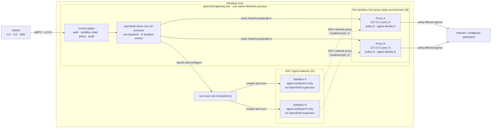
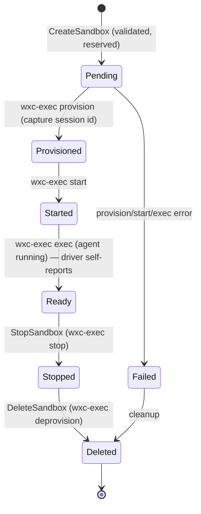

---
authors:
  - "@shailendra-nv"
state: review
links:
  - https://github.com/NVIDIA/OpenShell/issues/2050
  - https://github.com/NVIDIA/OpenShell/pull/2071
---

# RFC 0013 - 通过 MXC 计算驱动实现原生 Windows 支持

<!--
完整 RFC 流程和状态定义见 rfc/README.md。
-->

## 摘要

本 RFC 提议扩展 OpenShell，使其无需 Linux VM、Docker Desktop 或 WSL 即可在 Windows 11（x64 和 ARM64）上原生运行。将新增一个计算驱动 `openshell-driver-mxc`，使用 Microsoft Execution Containers（MXC，通过 `wxc-exec.exe`）作为沙箱原语。

核心架构结论是：OpenShell 拒绝在本设计中将其 Linux 沙箱内 supervisor 移植到 Windows。supervisor 在 Linux 上提供的价值层——出口策略执行（OPA）、L7 HTTP 检查——被迁移到宿主机：在驱动进程内运行 OpenShell 现有的 CONNECT 代理，并将 MXC 内置的 `network.proxy` 重定向指向它。因此集成简化为三个活动部件：原生 Windows OpenShell 网关、仅限 Windows 的 MXC 计算驱动 crate，以及未经修改的 `wxc-exec` 二进制文件，沙箱内不运行任何 OpenShell 二进制。

## 动机

OpenShell 为自主 AI 智能体提供沙箱。在 Linux 上，它通过 Docker、Podman、Kubernetes 和 libkrun-VM 计算驱动实现，每个驱动将计算后端与沙箱内 `openshell-sandbox` supervisor 配对，由后者执行策略并运行智能体。这些驱动都无法在 Windows 上提供一流体验：Docker Desktop 使用 WSL2 支持的 VM 运行 Linux 容器，带来许可和资源开销；WSL2 增加安装和网络复杂性；Hyper-V/Windows Sandbox 笨重且需要提权。目前，Windows 开发者或企业主机必须在其下搭建 Linux 运行时才能运行 OpenShell 沙箱。

Windows 是 OpenShell 目标智能体的主要环境，尤其是 GeForce 和企业 Windows 用户。我们希望提供原生、操作系统级隔离，无需提权即可运行，并具备与 Linux 用户相同的策略、推理和审计保证。Windows 11 预览版现已支持 MXC（`processcontainer`，由 AppContainer + 低完整性令牌支持）作为操作系统原生沙箱原语，已支持 `network.proxy` 出口重定向。这使得无需修改 Microsoft 运行时即可实现无 supervisor、宿主机强制执行的设计。

这值得一份 RFC 而非单个 Issue，因为它是一个跨领域的架构决策：新增计算驱动模型（进程内、无 supervisor）、新平台目标及其构建/CI 通道、OpenShell 策略与 MXC 配置之间的新策略转换接缝，以及原生 Windows 沙箱的新宿主机侧执行模型。它还使 OpenShell 对 Microsoft MXC 团队产生一系列依赖。这些决策值得广泛审查和持久记录。

如果保持当前设计不变，OpenShell 实际上仍仅限 Linux，Windows 用户被迫使用重量级 VM 变通方案，Windows 相关工作继续游离于公共项目之外。

## 非目标

- 将 `openshell-sandbox`（Linux supervisor）移植到 Windows，或发布任何沙箱内 OpenShell 二进制。本 RFC 拒绝该路径用于原生 Windows。
- 使 Windows 成为 Docker、Podman、Kubernetes 或 VM 运行时宿主。这些驱动保持为仅编译的配置桩，返回不支持错误。
- 在 MVP 中从 OCI 镜像或 Dockerfile 启动 MXC 沙箱。MXC 针对宿主机 Windows OS 运行，使用策略/配置，而非独立的 Linux 容器镜像。
- 命名管道驱动 IPC、跨进程 MXC 驱动二进制，或 MXC 的 tonic `ComputeDriverService` 适配器。驱动是进程内的。
- 在 MXC 内部实现完整 L7/端口/二进制范围策略执行。MXC 网络过滤是宿主机/IP/CIDR 级别；丰富策略保留在宿主机代理上。
- MSI/WinGet 打包、安装程序 UX、自动启动和后台网关管理。
- GPU 直通到 MXC 沙箱。
- 更改 Linux 或 macOS 的构建、运行时或驱动行为。所有 Windows 代码均以 `cfg(target_os = "windows")` 为门控。

## 提案

### 分层架构

Windows 上的 OpenShell 是四层栈，在 MXC 沙箱处有单一硬信任边界。当前范围内，网关作为用户启动的原生 Windows 进程运行。MXC 计算驱动和每沙箱宿主机 CONNECT 代理任务位于该进程内。智能体在 MXC AppContainer 内运行，所有出口重定向到其分配的宿主机代理监听器。

网关到沙箱的关系在控制和生命周期上是 1:N，但代理监听器到沙箱的关系是 1:1。每个沙箱注册表条目拥有一个 `HostProxyHandle`、一个沙箱特定策略和一个唯一的临时回环监听器。监听器标识沙箱，无需从共享代理端口上的连接推断归属。

决定性属性是 OpenShell 网络执行位于网关进程内的宿主机上，而非沙箱内。当前宿主机模式路径提供 L4 策略和明文/正向代理 L7 处理。HTTPS MITM 信任引导、推理/隐私路由和网关事件总线接线仍为后续工作。

这仍允许将现有 supervisor 网络代码复用为宿主机侧代理组件。边界是 Windows 不在 MXC 沙箱内运行 `ConnectSupervisor`、沙箱中继或任何 OpenShell 进程。

### 第 1 部分 - 原生 Windows 构建

本工作为 `x86_64-pc-windows-msvc` 和 `aarch64-pc-windows-msvc` 编译网关和 CLI，同时保持 Linux 和 macOS 不变。主要变更是一致性的 cfg 门控模式：每个实现为 Unix 特定的 crate 将其 Unix 主体移入 `*_unix.rs` 模块，并添加小型 `windows.rs`（或桩），在两个平台上保留公共库入口点和配置结构体。

- 不支持的驱动（Docker、Podman、Kubernetes、VM）变为仅编译的配置桩。网关仍解析所有驱动名称的现有配置文件，并在网关构造时（Docker/Kubernetes/Podman）或生成时（VM）返回明确的不支持错误，绝不出现解析失败或静默无操作。
- `openshell-core/build.rs` 按平台选择 vendored `protoc`（Windows 上 `protoc-bin-vendored`，其他平台 `protobuf-src`），使 proto 编译在 MSVC 下成功。
- Windows 路径默认值将配置解析到 `%APPDATA%` 下，状态/数据解析到 `%LOCALAPPDATA%` 下。
- 验证通过专用 `mise` 通道（`tasks/windows.toml` → `tasks/scripts/windows-msvc.ps1`）运行，以 `mise run --skip-tools windows:*` 调用，与默认 Linux `ci` 任务分离。包装器发现 Visual Studio 的 `VsDevCmd.bat`，添加 rustup MSVC 目标，并清除继承的 `RUSTC_WRAPPER`。
- `windows-msvc` GitHub Actions 作业在 `windows-2025` 上运行 x64 检查/构建/测试以及不支持驱动契约测试；ARM64 已搭建脚手架并禁用，直到有 ARM64 runner 可用。

Windows 构建目标有意包含 `openshell.exe` 和 `openshell-gateway.exe`。仅将网关作为 Linux 容器运行而由远程 Windows MXC 驱动管理原生沙箱，虽可缩小主仓库的 Windows 目标，但会重新引入 Linux 容器/VM 依赖，不符合本 RFC 的原生、低开销客户端系统目标。

### 第 2 部分 - MXC 计算驱动

`openshell-driver-mxc` 是一个完全位于 `cfg(target_os = "windows")` 之后的库 crate（其他平台为空壳）。它以进程内方式链接到 `openshell-server`，实现普通 Rust `ComputeBackend` trait——没有独立二进制、没有代理、没有 tonic 适配器。

| 模块 | 职责 |
|---|---|
| `driver.rs`（`MxcComputeBackend`） | 编排器：拥有注册表、验证规格、运行生命周期、驱动 `wxc-exec` 阶段、运行智能体、解析提供者凭据（Windows 凭据管理器）并注入、自报就绪、发出 watch 事件。 |
| registry | 内存 `Arc<Mutex<…>>`，映射 OpenShell 沙箱 id/名称 ⇄ MXC 会话 id + 阶段状态 + exec/PTY 句柄。Get/List/Watch 的事实来源（MXC 无 list-sessions API）。 |
| `mxc.rs` | 构建 MXC 配置 JSON、base64 编码、运行 `wxc-exec`、解析信封；封装 exec 与非 exec 的 stdout 语义和错误码映射。 |
| `policy.rs` | 将 `SandboxPolicy` proto → MXC 配置转换，拒绝不可执行的规则。委托给嵌入式策略映射器（见第 3 部分）。 |
| `openshell-supervisor-network::host` | 为每个沙箱在唯一 `127.0.0.1:<临时端口>` 监听器上启动一个宿主机 CONNECT 代理任务，应用该沙箱的裁剪网络策略和静态智能体身份，并在驱动注册表中保留其 `HostProxyHandle`。 |

#### 工作负载和软件可用性

MXC 不消费 Linux 容器运行时使用的 OCI 镜像模型。当前支持中，沙箱运行宿主机上已有的 Windows 软件，或通过显式 MXC 文件系统授权提供的软件，驱动提供智能体命令、工作目录、环境、凭据和策略派生的 MXC 配置。

这与 Linux 不同，Linux 沙箱镜像可携带独立的用户空间和依赖集。MXC `processcontainer` 和 AppContainer 路径共享宿主机 Windows OS；策略/配置创建隔离边界。如果 MXC 日后发展出 Windows VM 支持的镜像模型，OpenShell 可为该后端添加独立的引导/镜像工作流。

#### `wxc-exec` 接口契约

`mxc.rs` 调用器是与 MXC 的边界。调用始终为 `wxc-exec.exe --config-base64 <base64(JSON)> --experimental [--debug]`；`configurationId` 默认为 `composable`（绝不用 `small`——已知 OS bug）。调用器必须按阶段分支处理 I/O 语义：

| 阶段 | stdout | 退出码 | 解析为 |
|---|---|---|---|
| `provision` / `start` / `stop` / `deprovision` | 单个 JSON 信封 `{"result":…}` 或 `{"error":…}` | 0 成功 / 1 错误 | JSON 信封 |
| `exec` | 实时进程输出（非 JSON） | 脚本的退出码 | 原始字节 / 流 |

`provision` 返回要捕获的会话 id。MXC `error.code` 值（`not_provisioned`、`already_started`、`policy_validation`、`backend_unavailable` 等）映射为类型化错误。非零 `exec` 退出码是脚本结果，不是驱动错误。

#### 状态模型和生命周期

MXC 无远程清单 API，因此内存注册表是唯一事实来源。

`Ready` 在智能体启动后自报；不依赖任何 supervisor 连接。每次转换发出 `WatchSandboxes` 事件。`CreateSandbox` 将策略 → MXC 配置转换、解析并注入凭据，然后运行 `provision → start → exec`。实时 `connect`/`exec` 在 ConPTY 中生成新的 `wxc-exec phase=exec`，并将网关的双向流桥接到其 stdin/stdout——无 `ConnectSupervisor`、无沙箱内 SSH 服务器、无中继套接字。

MVP 中目前没有协调循环。如果操作员在 OpenShell 外删除 OpenShell 管理的 MXC/AppContainer 资源，`get`、`list` 和 `watch` 将继续反映驱动注册表，直到后续操作触及缺失的 MXC 资源并可标记沙箱失败或未找到。持久协调是后续工作：在 SQLite 中持久化 OpenShell 沙箱 id ⇄ MXC 会话 id 映射，启动时探测或取消配置已知会话，并在 MXC 暴露 list/inspect API 时添加定期协调循环。

#### 受管出口

受管出口是核心价值层。启用时，`egress_proxy_addr` 作为回环地址种子。对每个沙箱，MXC 驱动保留配置的 IP 并绑定端口 `0` 分配新的临时端口。它使用该沙箱的裁剪仅网络策略启动现有 OpenShell 宿主机 CONNECT 代理，然后将分配的端口写入 MXC 的 `network.proxy = { localhost: N }` 重定向。AppContainer 内的回环是宿主机回环，因此沙箱出口到达网关进程内 MXC 驱动中运行的代理。

宿主机监听器到沙箱的拓扑是 **1:1**，而非多对一。多个沙箱共享 `127.0.0.1`，但每个活动沙箱在驱动注册表中拥有唯一临时端口和宿主机代理句柄。由此产生的 `127.0.0.1:<port>` 元组将每个入站代理连接限定到恰好一个沙箱，无需从共享回环流量推断沙箱身份。沙箱停止、退出或失败时丢弃句柄，终止该沙箱的代理接受循环。

由于 MXC 不暴露 Linux procfs 套接字所有权，代理根据监听器的沙箱策略和从配置的 `agent_command` 派生的静态沙箱智能体身份评估每个连接。当前宿主机模式路径通过 OPA 评估 L4 宿主机:端口允许/拒绝，处理明文和正向代理 L7 流量，并发出 OCSF 事件。HTTPS MITM 信任引导和网关拒绝/活动总线接线仍为后续工作。默认 `processcontainer` 后端已支持 `network.proxy`，因此本设计无需 MXC 更改。

### 第 3 部分 - OpenShell 与 MXC 之间的策略转换

OpenShell 策略以 YAML 编写，由共享跨平台 `openshell-policy` crate 解析为 `SandboxPolicy` proto。MXC 驱动不重新解析 YAML；专用 Rust 策略映射器（嵌入驱动并自动调用）将 proto IR 映射到 MXC `ContainerConfig`，并**拒绝而非静默丢弃** MXC 无法执行的任何内容。MXC 强制 provision 时与 exec 时的分离。

| OpenShell 策略 | 执行位置 | MXC 映射 | 时机 |
|---|---|---|---|
| 文件系统读/写路径 | MXC | `filesystem.readwritePaths` | provision |
| 文件系统只读路径 | MXC | `filesystem.readonlyPaths` | provision |
| 文件系统拒绝路径 | MXC | 有限 / 不支持 | provision |
| 进程（uid/gid/seccomp） | —（无对应） | 拒绝（默认） | — |
| 网络（OPA / L7 / 推理 / 隐私） | 宿主机 CONNECT 代理 | `network.proxy = { localhost: N }` 重定向 | provision |

主要受管出口设计**不**尝试将完整 OpenShell 网络策略映射到 MXC 网络策略。MXC 接收故障关闭重定向层：`network.defaultPolicy = "block"`、空直接允许列表和 `network.proxy = { localhost: N }`。原始 OpenShell `network_policies` 保留并交给宿主机 CONNECT 代理，后者仍负责端口、