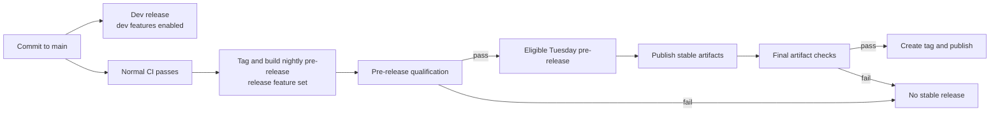

---
authors:
  - "@drew"
state: review
links:
  - https://github.com/NVIDIA/OpenShell/pull/2148
  - https://github.com/NVIDIA/OpenShell/pull/2695
---

# RFC 0014 - Alpha 退出标准与稳定版本发布策略

## 摘要

本 RFC 旨在定义 OpenShell 退出 alpha 阶段的标准，并为生产用户和生态开发者建立可预期的发布周期。

我们提议：

- 每次提交到 `main` 都发布开发版本，每晚构建预发布版本，每周二发布合格的稳定版本。
- 定义 Stable 与 Experimental API 的成熟度、兼容性和版本管理规则，并维护最新及 N-1 次版本线。
- 建立发布资格流水线，覆盖一致性、升级、API 变更和安全审查，贯穿受支持的发布矩阵。

## 动机

目标是在不拖慢 OpenShell 开发的前提下退出 alpha。发布应保持高频和自动化，Experimental API 应能快速演进以跟上生态节奏。同时，用户需要可以放心构建的 Stable 接口。

从 `0.1.0` 起，OpenShell 同时提供两者：Stable 接口有明确的兼容性契约，Experimental API 和功能有演进空间。发布版本只有在通过一致性、升级、兼容性、构建产物和安全检查后，才可在已发布的支持矩阵内用于生产。

## 提案

### 发布节奏

从 `0.1.0` 起，OpenShell 发布带标签的稳定版本，供生产环境在已发布的支持矩阵内使用。稳定版本每周二发布，默认递增补丁版本号，例如 `0.1.1` 之后是 `0.1.2`。当引入重要新功能或有文档记录的破坏性变更时，可改为递增次版本号。只有在存在变更且所有阻塞性资格套件通过时，才发布稳定标签。

每次提交到 `main`，OpenShell 都发布一个开发版本。每个开发版本标明其源提交和构建产物清单，浮动别名 `dev` 指向最新版本。开发版本启用所有开发编译标志和功能，让功能作者、早期采用者和集成方能在稳定版本之间获取即将到来的变更。这也允许大型功能在编译时功能标志后开发数周，而不将未完成的功能带入稳定发布轨道。开发版本已通过常规 CI，但未通过发布资格验证，不适用于生产。

当 `main` 有变更且常规 CI 通过时，OpenShell 为下一个预期稳定版本构建每晚预发布版本。`0.1.1` 之后，预发布版本编号为 `0.1.2-pre.1`、`0.1.2-pre.2`，依此类推。功能可在预发布版本之间合入。首个预发布版本锁定该周发布列车的版本号。一旦补丁列车启动，需要次版本发布的破坏性变更将排入下一周；列车不会从补丁版本切换为次版本。

预发布版本为自动化发布资格和 QA 系统提供不可变的构建产物集以供评估，也供需要验证候选稳定版本的维护者和集成方使用。预发布版本使用与稳定版本相同的发布功能集，仍可能未通过资格验证，不适用于生产。每晚构建一次，可在周二之前修复失败并重新评估。

| 发布类型 | 目标用户 | 内容与预期 |
| --- | --- | --- |
| 开发版本 | 功能作者、早期采用者、测试即将发布功能的集成方 | 每次提交到 `main` 即发布；启用开发功能；通过常规 CI 但未通过发布资格验证 |
| 预发布版本 | 自动化资格验证、维护者、验证下一稳定版本的集成方 | 每晚从符合条件的 `main` 构建；使用稳定功能集；不可变但尚未取得生产资格 |
| 稳定版本 | 需要已发布兼容性和支持契约的生产用户及下游集成 | 每周二从通过所有阻塞性资格套件的预发布版本发布 |

### 项目版本与兼容性契约

版本 `0.1.0` 开启 OpenShell 的受支持兼容性契约。对于 `0.x` 系列：

- 补丁版本可包含缺陷修复和增量式、向后兼容的功能，不主动破坏稳定接口。
- 次版本可代表重要新功能，即使保持向后兼容；也可包含有文档记录的稳定接口破坏性变更，例如 `0.1.x` 到 `0.2.0`。

[发布版本选择补充说明](release-version-selection.md)定义了 Conventional Commits 如何选择下一个补丁或次版本预发布版本。

### API 与功能成熟度

公共 API 默认为 Stable。预期频繁变更的 API 必须显式标记为 Experimental。Protobuf 包在版本名称中编码该标记。SDK 使用符合语言习惯的包、模块、命名空间或符号命名来体现相同标记。

| 成熟度 | Protobuf 命名 | SDK 命名 | 兼容性 |
| --- | --- | --- | --- |
| Stable | `v1` 或 `v2` | 默认 Stable 包、模块、命名空间或符号 | 跨补丁版本向后兼容；次版本中可变更，但需通知并提供迁移指引 |
| Experimental | `v1experimental` | 语言特定的 Experimental 包、模块、命名空间或符号 | 补丁版本中可变更或移除，无需通知 |

无论出现在稳定版、预发布版还是开发版构建产物中，每个 API 和功能都属于 Stable 或 Experimental。每个 SDK 必须记录其语言特定的命名约定，Experimental 接口不得看起来像 Stable。

Experimental API 用于快速迭代，可原地变更，不提供兼容性保证。毕业时新增 Stable `v1` 包，而非原地重命名 Experimental 包。

未发布功能使用具名编译时标志（如 `unstable-<feature>`），统一归入 `dev` 编译标志。开发版本启用它们；稳定版本和预发布版本在服务二进制、CLI、配置和文档中排除它们。目前，当 SDK 命名约定能传达成熟度时，SDK 分发可包含其生成的类型和客户端方法。

### 破坏性变更与 API 版本管理

对 Stable API 或其他稳定 OpenShell 表面的破坏性变更需要次版本发布，并附通知和迁移指引。这适用于 Protobuf、SDK、CLI、配置、策略、Helm 和状态接口。Experimental API 的破坏性变更若不破坏 Stable 接口，可在补丁版本中发布且无需通知。

破坏性变更检测在代码审查时运行，并在预发布资格验证时再次运行。Stable protobuf 包使用 Buf 的 `FILE` 规则，对照最新稳定基线以及 N-1 维护承诺所需的额外受支持基线。语言特定的 API 检查或 agent 审查技能覆盖公共 SDK。

以下示例说明这些规则如何影响预发布版本：

| 示例 | 具体变更 | 发布处理 |
| --- | --- | --- |
| 破坏 Stable Protobuf 契约 | `string policy = 7` 改为 `PolicyReference policy = 7` | 阻止补丁发布，需要 OpenShell 次版本发布。 |
| 破坏 Experimental Python SDK 方法 | `create_sandbox(timeout=30)` 改为 `create_sandbox(deadline=...)` | 可在补丁版本中发布，无需通知。 |
| 破坏稳定策略文档 | `endpoints:` 改为 `destinations:` | 阻止补丁发布，除非两个字段均保持支持。 |
| 破坏稳定 CLI 契约 | `--policy policy.yaml` 改为 `--policy-file policy.yaml` | 需保留旧标志作为别名，或发布次版本。 |

### 预发布资格验证与稳定版本发布

发布系统将预发布创建、资格验证和稳定发布分离：

每个预发布版本在资格验证前打标签，并生成清单，包含版本、源提交、构建输入、构建产物摘要、SBOM、来源证明和资格验证结果。资格验证针对这些构建产物运行，而非替代的源码构建。预发布版本存储在构建产物存储中，不发布为 GitHub Releases，遵循 [Bazel 滚动发布模型](https://bazel.build/release/rolling)。任何变更都会创建新的预发布版本。

发布资格验证由[发布资格补充说明](release-qualification.md)中定义的四个套件组成：

- **一致性**：在受支持的驱动和网关配置上运行，验证核心沙箱行为、策略执行和扩展契约。
- **升级**：每个受支持的安装包运行一次，验证其升级路径、状态迁移、升级后健康检查，以及承诺的回滚。
- **破坏性 API 变更审查**：每个预发布版本运行一次，将稳定 protobuf 和 SDK 接口与所有适用的兼容性基线比较。
- **安全审查**：每个预发布版本运行一次，验证安全扫描结果，审查安全敏感边界的变更，并确认每个发现都有所需的处置。

初始发布目标定义在[构建矩阵](build-matrix.md)中，阻塞性覆盖范围定义在[发布资格补充说明](release-qualification.md)中。

每周发布为最新的合格预发布提交打上下一个稳定版本标签，并发布稳定构建产物。

### 维护与回移

OpenShell 维护两条发布线：最新次版本和 N-1。支持适用于每条线上的最新补丁。使用旧补丁的用户应更新到新的维护补丁，而非为每个历史补丁单独提供修复。

维护版本包含关键可靠性修复和安全修复，不回移功能。修复在适当的主分支上开发，当旧发布线受影响时回移到 `release/<major>.<minor>` 分支。每个回移需通过该发布线适用的兼容性、回归、打包和受支持升级资格验证。

例如，若当前为 `0.3.1`，且某漏洞也影响 0.2 线，OpenShell 从维护中的 0.2 分支发布下一个可用的 `0.2.x` 补丁。安全版本可立即发布，无需等待下周二。

## 实施计划

1. **保留每次提交的开发版本，每晚构建 0.1.0 预发布版本。** 每次提交到 `main` 都启用所有开发功能构建，并发布连续的 `0.1.0-pre.N` 构建产物，使用通向 0.1.0 的发布功能集。
2. **完成必要的破坏性 API 变更。** 利用 0.1.0 之前的窗口最终确定 Stable 接口，将演进中的 API 移至 Experimental 包，并建立兼容性基线。
3. **构建资格测试和发布机制。** 自动化兼容性检测、一致性、升级、破坏性 API 变更审查、安全资格验证、构建产物验证和发布门禁。
4. **发布 0.1.0。** 选择一个合格的预发布版本，发布稳定构建产物和支持指引，并启动每周发布节奏。