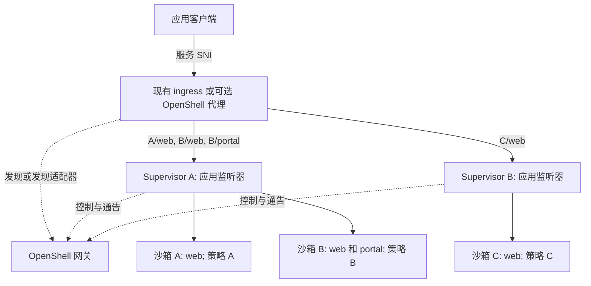

---
authors:
  - "@drew"
  - "@TaylorMutch"
state: draft
links:
  - https://github.com/NVIDIA/OpenShell/issues/4266
  - https://github.com/NVIDIA/OpenShell/pull/4267
  - https://github.com/NVIDIA/OpenShell/issues/994
  - https://github.com/NVIDIA/OpenShell/issues/1791
  - https://github.com/NVIDIA/OpenShell/issues/4210
  - https://github.com/NVIDIA/OpenShell/pull/4213
  - https://github.com/NVIDIA/OpenShell/issues/1794
  - https://github.com/NVIDIA/OpenShell/issues/3402
  - https://github.com/NVIDIA/OpenShell/issues/4229
  - https://github.com/NVIDIA/OpenShell/issues/2469
  - https://github.com/NVIDIA/OpenShell/issues/3715
---

# RFC 0017 - 沙箱服务暴露

## 摘要

为 supervisor 增加专用的应用监听器。该监听器解析服务主机名，并按策略将 HTTP 和 WebSocket 流量转发到正确的沙箱，独立于 supervisor 的网关控制连接。

Supervisor 向网关通告服务以供发现。运维人员可将现有 ingress 与这些监听器集成，或使用可选的 `openshell-sandbox-proxy` 参考实现。应用流量绕过网关，使 ingress 可独立扩展。简单部署仍可使用网关路由。

## 动机

服务暴露需要满足以下要求：

1. **独立扩展。** 防止应用流量占用控制平面操作所需的资源。
2. **独立访问限制。** 对控制平面流量和应用流量应用不同的网络规则。
3. **应用自有认证。** 无需 OpenShell 请求认证即可提供应用服务，使应用能自行认证客户端。
4. **平台托管认证。** 通过控制平面所用的认证基础设施（如 Cloudflare tunnels 和零信任代理）保护应用。
5. **路由到共享 supervisor。** 支持未来由单个 supervisor 服务多个沙箱，每个沙箱有独立策略。
6. **可扩展 ingress。** 让运维人员通过网关发现集成现有 ingress，可选 OpenShell 代理作为参考实现。

## 非目标

- 实现多租户 supervisor；在路由设计中为其预留空间。
- 将 SSH、执行、CLI 端口转发或文件上传移出当前路径。
- 增加任意 TCP/UDP 暴露、自动端口发现或应用复制。
- 替换出站策略、provider 处理或隔离后端契约。
- 移除网关路由或自动迁移现有 URL。

## 提案

### 现状

`openshell service expose my-sandbox 8080 web` 注册服务并返回形如 `https://default--my-sandbox--web.<gateway-base-domain>/` 的 URL。

网关解析 HTTP 主机名，并通过 supervisor 中继将应用流量转发到沙箱的 loopback 端口。服务请求绕过控制平面 RPC 授权，但共享网关进程、监听器 TLS 要求和 supervisor 传输。

### 缺失的能力

- **独立扩展。** 另一个前端或网关监听器仍会通过网关发送应用载荷。需要一条通往 supervisor 应用监听器的独立路径。
- **独立访问限制。** 应用需要独立的监听端口和 TLS 策略。仅靠不同主机名无法提供网络访问边界。
- **认证灵活性。** 应用已可接收 bearer 凭证或置于边缘认证之后，但继承了网关 TLS 要求。它们需要独立的应用监听器；服务路由不会自动继承 OpenShell OIDC 或工作区授权。
- **服务发现。** Ingress 需要找到服务每个沙箱的 supervisor，并跟踪所有权变更，包括一个 supervisor 服务多个沙箱的情况。

### Supervisor 应用监听器

核心功能是每个 supervisor 上的应用专用监听器，独立于其网关连接和管理 API。它解析服务主机名，应用所选沙箱的策略，并将流量转发到该沙箱声明的服务端口。

Supervisor 通过每个沙箱的隔离后端 loopback 连接器访问服务，定义见 [RFC 0012](../0012-isolation-backend/README.md)。流量不会直接到达沙箱。

网关管理声明和发现。监听器和发现 API 为运维管理的 ingress 和可选 OpenShell 代理提供集成点。两者均可通过 TLS Server Name Indication (SNI) 选择 supervisor。



实线箭头承载应用流量；虚线箭头承载控制流量。发现独立于哪个网关副本拥有其控制会话，标识 supervisor 应用端点。

应用 ingress 独立于网关扩展。Supervisor 仍在应用和控制工作之间共享资源，因此连接、缓冲区和每沙箱并发限制必须保留控制平面容量。

### 驱动集成

应用监听器和发现契约独立于计算驱动。驱动特定的网络提供可达性，不改变服务身份或 supervisor 策略执行。

每个受支持的驱动配置一个 supervisor 应用监听器及其可达地址，包括所需的端口分配或转发。Supervisor 通过网关通告接受的沙箱服务。Ingress 实现者消费发现并路由到所属 supervisor；可使用现有 ingress 基础设施或可选 OpenShell 代理。

地址必须可从所选 ingress 部署访问：仅当 ingress 共享同一网络上下文时 loopback 才足够。同一主机上的多个 supervisor 需要不同的监听端口或地址。

驱动管理端点分配、重启、替换和删除；通告和发现必须跟踪这些变更。通告的端点始终到达 supervisor 应用监听器，绝不到达工作负载端口。这些职责使服务身份、发现和沙箱策略执行在各驱动间保持一致。

架构支持不意味着每个驱动都在首个版本中发布。仅在该驱动的端点集成实现并验证后，才启用 supervisor ingress。

### Kubernetes

Kubernetes 运维人员可使用现有 ingress 加发现适配器路由到 supervisor Service。这使用相同的应用监听器和发现契约。

Supervisor Service 是通用驱动契约的 Kubernetes 映射；其他驱动通过自身网络提供可达性。

多个沙箱服务可共享一个 supervisor Service。跨不同沙箱所有者的 supervisor 的 Service 仍需选择正确所有者的路由。Ingress 必须保留服务 SNI 或使用明确支持的 TLS 终止模式。

### 可选参考代理

`openshell-sandbox-proxy` 是一个额外的可选二进制，拥有自己的监听器、发现凭证、缓存、限制和指标。副本可置于负载均衡器之后并独立发现路由。

它也是集成其他 ingress 系统的参考实现：消费网关路由更新、按 SNI 选择所属 supervisor、连接其应用监听器。

### 服务与发现

保留现有工作流，包括创建时暴露和未命名服务：

```shell
openshell service expose sandbox-a 8080 web
openshell service expose sandbox-b 8080 web
openshell service expose sandbox-b 9000 portal
openshell service expose sandbox-c 8080 web
```

网关将声明发送给所属 supervisor。Supervisor 在每个沙箱的策略下安装允许的路由并通告回来。网关验证所有权并发布接受的路由。通告不能扩大声明，通告的路由也不证明应用健康。

增加带认证的只读发现，提供快照和变更 watch。每条路由包含主机名、沙箱和服务 ID、supervisor 身份和应用地址、修订号、运行时代次和过期时间。地址来自可信的运维/驱动配置。发现访问限定在路由器的工