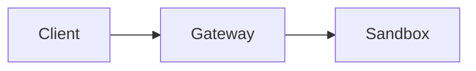

# OpenShell RFC

对 OpenShell 的重大变更应在开始实现前以书面形式提出。新功能始终以 GitHub Issue 起步，使用[功能请求模板](https://github.com/NVIDIA/OpenShell/issues/new/choose)，而非 RFC Pull Request。RFC 用于推动需要结构化迭代、广泛利益相关者输入，以及超出 Issue 评论所能承载的持久推理记录的细致讨论。

RFC 提供了一种一致的方式来收集广泛反馈、建立共识，并为未来的贡献者记录决策。只有当维护者认定原始 Issue 需要该级别的设计评审时，才会创建 RFC。

## 从 GitHub Issue 开始

在编写 RFC 之前，你必须打开一个 [GitHub Issue](https://github.com/NVIDIA/OpenShell/issues/new/choose) 来界定问题范围、评估兴趣并获取早期反馈。对于新功能，请使用功能请求模板。这有助于：

- 验证问题是否值得解决
- 尽早暴露潜在问题
- 在投入详细提案之前建立共识
- 确定合适的评审者和利益相关者

如果该 Issue 显示出足够的兴趣，且维护者认定该想法需要广泛的设计评审，他们会要求基于该 Issue 提交 RFC。维护者在创建 RFC 之前会在 Issue 中分配 RFC 编号并添加 `needs-rfc` 标签，以防止跨分支的编号冲突，并使待处理的 RFC 工作可被搜索。

## RFC 与其他工件

OpenShell 有多个存放设计信息的地方。使用以下指南选择正确的载体：

| 工件 | 用途 | 何时使用 |
|----------|---------|-------------|
| **GitHub Issue** | 跟踪和界定 Bug、功能请求或初步想法 | 始终从这里开始；新功能使用功能请求模板 |
| **Spike Issue**（`create-spike`） | 调查已界定变更的实现可行性 | 你需要探索代码库并为特定组件或功能产出可构建的 Issue |
| **RFC** | 提出需要广泛共识的跨领域决策 | 维护者从现有 Issue 要求提交 RFC 并分配了 RFC 编号 |

关键区别：**Spike 调查某事是否可行以及如何实现；RFC 提出我们应该做这件事并就方案寻求一致。** Spike 可以先于 RFC（收集数据）或后于 RFC（充实实现细节）。

## 何时使用 RFC

当讨论本身需要结构时使用 RFC：多轮反馈、相互竞争的权衡、广泛的利益相关者输入，或持久的设计记录。如果重要上下文会在 Issue 评论中丢失，RFC 就是正确的工具。以下是维护者在 Issue 打开后可能要求提交 RFC 的示例：

- 平台的架构或设计决策
- 对 API 或命令行工具的变更
- 对内部 API 或工具的变更
- 新增或变更公司或团队流程
- 测试设计

RFC 不仅适用于技术想法，也适用于整体项目想法和流程。如果你有改进某事做法的想法，你有权让你的声音被听到。

## 何时不使用 RFC

并非所有事情都需要 RFC。以下情况跳过 RFC 流程：

- Bug 修复
- 限定在单个组件内的小功能新增（改用 Spike）
- 可通过 Issue、Spike 和 Pull Request 工作流解决的功能请求
- 文档变更
- 依赖更新
- 不改变公共接口的重构

如果变更不需要跨团队共识，GitHub Issue 或 Spike Issue 就是正确的载体。

## RFC 元数据与状态

每个 RFC 文档开头都包含少量 YAML front matter 元数据：

```yaml
---
authors:
  - "@username"
state: draft
links:
  - https://github.com/NVIDIA/OpenShell/issues/456
  - https://github.com/NVIDIA/OpenShell/pull/123
---
```

我们跟踪以下元数据：

- **authors**：RFC 的作者（因此也是所有者）。以 GitHub 用户名列出。
- **state**：必须是下文讨论的状态之一。
- **links**：相关 PR 或 Issue。第一个链接应为维护者要求提交 RFC 并分配编号的原始 Issue。随着 RFC 推进添加条目。
- **superseded_by**：*（可选）* 对于处于 `superseded` 状态的 RFC，替换此 RFC 的编号（例如 `0005`）。

RFC 可以处于以下状态之一：

| 状态 | 描述 |
|-------|-------------|
| `draft` | RFC 正在编写中，尚未准备好进行正式评审。 |
| `review` | 在 Pull Request 中积极讨论中。 |
| `accepted` | 提案已被接受，可以开始实现。 |
| `rejected` | 提案经评审后被拒绝。 |
| `implemented` | 该想法已完全实现。变更将不频繁。 |
| `superseded` | 被更新的 RFC 取代。`superseded_by` 字段应引用替代者。 |

## RFC 生命周期

### 1. 打开 GitHub Issue

从 GitHub Issue 开始。新功能必须使用功能请求模板，并包含足够的设计上下文，以便维护者和贡献者评估该想法。在 Issue 存在之前不要打开 RFC PR。

### 2. 获得维护者确认

维护者从 Issue 判断是否需要 RFC。如果需要，他们会在任何人创建 RFC 分支或文件夹之前，在 Issue 中分配 RFC 编号，并向原始 Issue 添加 `needs-rfc` 标签，以便待处理的 RFC 工作可被搜索。作者应使用分配的编号，而非自行选择。

### 3. 创建你的 RFC

每个 RFC 位于自己的文件夹中：

```text
rfc/NNNN-my-feature/
    README.md
    (optional: diagrams, images, supporting files)
```

其中 `NNNN` 是维护者分配的 RFC 编号（零填充至 4 位），`my-feature` 是简短的描述性名称。主要提案放在 `README.md` 中，以便 GitHub 在浏览文件夹时渲染它。

要开始新的 RFC，复制模板文件夹：

```shell
cp -r rfc/0000-template rfc/NNNN-my-feature
```

填写元数据，在 `links` 中包含原始 Issue，然后开始编写。迭代期间状态应为 `draft`。

### 4. 打开 Pull Request

当你准备好获取反馈时，将状态更新为 `review` 并打开 Pull Request。将 PR 链接添加到元数据的 `links` 中。维护者应为 PR 添加 `rfc` 标签，并将其添加到 [RFC 看板](https://github.com/orgs/NVIDIA/projects/233/views/6)。

PR 是讨论发生的地方。任何订阅该仓库的人都会收到通知，可以阅读你的 RFC 并提供反馈。

### 5. 迭代并建立共识

作为 RFC 的所有者，你选择接受哪些评论由你决定，但在互动方式上应保持同理心。对于提供反馈的人，请确保所有反馈都是建设性的。

RFC 很少原封不动地走完这个过程。将编辑作为新的提交推送到 PR，并留下评论解释你的更改。

### 6. 合并 Pull Request

在留出时间供他人评论后，RFC 作者请求合并，维护者批准并合并。状态应从 `review` 更新为 `accepted`。如果提案被拒绝，状态应设为 `rejected`。时机由作者自行决定。作为指导，几个工作日似乎合理，但具体情况可能要求不同的时间线。

当 RFC 被接受时，维护者应更新 RFC 看板上跟踪评审状态的字段。

一般来说，如果没有人阅读或评论过 RFC，就不应合并。如果没有人阅读你的 RFC，是时候明确请人读一读了！

### 7. 实现

一旦 RFC 完全实现，其状态应移至 `implemented`。这代表已充分发展的想法。虽然允许对已实现的 RFC 进行讨论，但变更预计不会频繁。

## 图表

当 RFC 需要图表来说明架构、数据流或组件交互时，使用直接嵌入 Markdown 的 [Mermaid](https://mermaid.js.org/) 图表。Mermaid 在 GitHub 上原生渲染，并让图表与文本一起进行版本控制。

````markdown

````

尽可能优先使用 Mermaid 而非外部图片文件。如果图表对 Mermaid 来说过于复杂（例如详细的 UI 原型），将图片提交到 RFC 文件夹中与其 `README.md` 并列，并使用相对路径引用。

## 修改 RFC

RFC 合并后，始终有机会进行修改。打开一个包含你想要修改内容的 Pull Request。如果你不是原作者，请务必 @ 原作者，确保他们看到并批准更改。

## RFC 推迟

当提案被拒绝，或我们希望在未来某个时间之前既不评估提案也不实现它时，某些 RFC 会被标记为 `rejected`。被拒绝的 RFC 可能在时机成熟时重新审视。